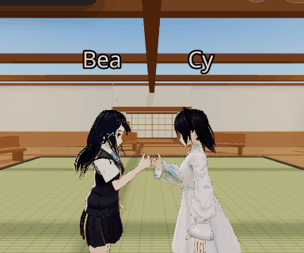

# Seiza documentation

This guide covers deploying, configuring, customizing, and understanding
Seiza. For a short introduction, see [README.md](README.md).

Seiza is a serverless reference architecture for self-hosted, standards-based
multiplayer WebXR. Each deployment runs entirely on the deployer's own
Cloudflare account. The maintainers don't operate any server: you deploy it,
and you own the data and the bill.

## Contents

- [Overview](#overview)
- [Features](#features)
- [Get started](#get-started)
- [Configure a deployment](#configure-a-deployment)
- [Use Seiza](#use-seiza)
- [How it works](#how-it-works)
- [Performance](#performance)
- [Project layout](#project-layout)
- [Known limitations](#known-limitations)
- [License](#license)

## Overview

### What Seiza is

Seiza is a small 3D world that people walk around in together from a web
browser. You pick a name and an avatar, open a link, and you're in a room
with everyone else who opened the same link. There's nothing to install, and
you don't need a headset, though Seiza supports one.

In a room, you can:

- Walk around indoors and out into a garden, and sit on chairs and benches.
- Talk using your microphone. Voices get quieter with distance, so two small
  conversations can share one room.
- Turn on your camera, or share your screen onto a wall screen.
- Write on the notice boards and leave notes. Anyone in the room can do this.
- Wave, bow, clap, raise your hand, and use other gestures. Your avatar's face
  changes to match.
- Chat by text.

### How Seiza differs from hosted platforms

- **It runs on your account.** Hosted tools such as FrameVR, and Mozilla Hubs
  before it closed, run on a company's servers at the company's prices for as
  long as the company chooses. You set up Seiza on your own Cloudflare
  account, so nobody else can shut it down, change its price, or lose your
  data.
- **It complements those tools.** Seiza doesn't try to match a commercial
  product's features. It's a smaller, self-hosted option for a class, a small
  event, a tight budget, or any case where you want your data under your
  control.

Hosted platforms do disappear. Mozilla Hubs shut down in 2024 with a few
months' notice. Ready Player Me closed in January 2026, and Spatial.io retired
its free 3D worlds in July 2026. When you run Seiza yourself, that decision
stays with you.

### Cost

For a class-sized room, Seiza is usually free. It fits in Cloudflare's free
tiers, and audio and video travel directly between browsers, so they never
pass through your server.

The one part that can cost money is a TURN relay, described in
[Voice and video across networks](#voice-and-video-across-networks).
Cloudflare includes 1,000 GB of relayed traffic per month before charging.

#### How much the free plan covers

The room server's limit is requests, not people. Each participant sends at
most 5 position updates a second, and Cloudflare bills incoming WebSocket
messages at 1 request per 20, so a person moving the whole time costs about
**900 requests an hour**. A seated or idle person sends only a heartbeat
every 5 seconds (every 30 in a hidden tab), so real classes cost much less
than the figures below, which assume everyone is moving. Headset users cost
about three times as much, because they also send hand and head tracking.

The free plan allows 100,000 requests a day, which resets at 00:00 UTC
(8:00 in the Philippines). When it runs out, rooms stop working until the
reset. That is about:

| Room | Free hours a day, everyone moving |
| --- | --- |
| 4 people | about 28 |
| 12 people | about 9 |
| 16 people (the default limit) | about 7 |
| 30 people | about 3.7 |
| 40 people | about 2.8 |

The room server's running time (13,000 GB-s a day) covers about 28
room-hours a day, so it only matters for many small rooms.

#### If you outgrow it: Workers Paid, US$5 a month

The paid plan is $5 a month per Cloudflare account, for every Worker in it.
It never stops a room mid-class; usage beyond what it includes is billed
instead. It includes 1 million room-server requests and 400,000 GB-s a month,
with further requests at $0.15 per million.

| Room, in one world | Hours a month within the $5 | About per weekday |
| --- | --- | --- |
| 12 people | 93 | 4.2 |
| 16 people | 69 | 3.2 |
| 30 people | 37 | 1.7 |
| 40 people | 28 | 1.3 |

Every further US$1 buys about 7,400 person-hours, for example 185 hours of a
40-person room. As a worked example, two worlds each holding two sessions a
week of 20 to 40 people for 2 to 3 hours (about 17 sessions a month) come to
$5.00 to $5.30 a month.

Two things to know before upgrading:

- There is no built-in spending cap. Set a billing notification in the
  Cloudflare dashboard (at $7, say) so a surprise shows up early.
- The free plan's daily allowance adds up to more requests a month (about 3
  million) than the paid plan includes (1 million). What the $5 buys is never
  being cut off mid-class.

#### Media

TURN relays and Cloudflare's media forwarding service (its Realtime SFU,
which Seiza doesn't use yet) share one allowance: the first 1,000 GB each
month is free, then $0.05 per GB of egress. A relayed participant uses about
0.16 GB an hour for voice and about 0.75 GB with cameras on, so the free
allowance covers well over a thousand relayed person-hours a month. Check
[Cloudflare's pricing](https://developers.cloudflare.com/workers/platform/pricing/)
before relying on these numbers; they were taken in October 2026.

### Who controls a room

Anyone can join, walk around, talk, present, and write on boards. Changing the
room itself (adding furniture, moving things, or swapping the environment)
can require a password. If the deployer sets an **admin key**, whoever has it
gets a participant list and can mute someone, remove someone, teleport to
someone, or gather everyone to one spot. See [ADMIN.md](ADMIN.md).

Two limits apply:

- Voice travels directly between browsers, so "mute" is a request that the
  other browser follows. The server can't force it.
- There are no user accounts, so removing someone ends their session but
  can't stop them from rejoining.

### Skills you need

- **To join a room**, you only need the link.
- **To run your own**, you need to follow a setup guide and run a few
  commands. It isn't a coding project, but it isn't one click either. See
  [Deploy your own instance](#deploy-your-own-instance).

### Your data

Everything placed in a room, and everyone in it, lives on the Cloudflare
account of the person who deployed it. The Seiza project doesn't run a
server. Voice and video don't pass through the deployer's server either. See
[Known limitations](#known-limitations) for what Seiza does and doesn't
guarantee yet.

## Features

- **A built-in world.** The default world has a hall with benches around a
  tatami platform, a corridor of shoe lockers, a classroom with desks facing a
  chalkboard, a garden with a pond and two lampposts, and, past the garden,
  a meadow with a campsite, where everyone arrives. You can sit on every
  chair and bench, and on the camp chairs round the fire. See
  [The meadow and the campsite](#the-meadow-and-the-campsite).
  The world, including its textures and sky, is generated in code, so no 3D
  assets are bundled and nothing is fetched from another CDN. You can add
  your own glTF scene through `world.json`.
- **A living sky.** The sky follows Philippine time: the sun rises and sets
  where it really would, dusk passes through the golden hour and twilight
  into a starry night, and the weather changes through the day, from clear
  to cloudy to rain. Every visitor sees the same sky, because it's worked
  out from the clock rather than sent over the network. A world can keep the
  original still sunset instead, and an editor can set a room's time and
  weather from the bottom of the edit panel; see
  [Sky and weather](#sky-and-weather).
- **Movement.** Move with WASD or the arrow keys, run with Shift, and jump
  with Space. VR has thumbstick movement. Double-click the floor to walk
  there along a navigation mesh route. Drag to look around, as in FrameVR.
  Seiza never locks the pointer, so the cursor stays free for the interface
  and the editor. Switch between first and third person, and scroll to zoom
  (field of view in first person, distance in third). In first person you
  see from your avatar's own eyes: look down to see your body and feet, and
  the view kneels into seiza with you and dips and turns with bows, nods, and
  other gestures. Your head is hidden from your own camera only, so others see
  you unchanged. In third person, your avatar
  turns to face where it walks. Click a chair or bench to sit, and
  move to stand up.
- **Voice chat.** Voice uses a peer-to-peer WebRTC mesh, signaled through the
  room server that also syncs positions. A 3D indicator shows who is
  speaking. Voices play at full volume within 3 m, talking range, then
  fade smoothly to silence at 16 m. Every voice is boosted and held under a
  limiter, so a quiet microphone is easy to hear and a loud one doesn't
  distort (`voiceVolume` in `src/media/meshPolicy.ts`). There's no separate media
  server; see [Known limitations](#known-limitations) for the scaling limit
  this sets. Voice is on unless you turn it off with `voiceEnabled` in
  `world.json` or the `VITE_SEIZA_VOICE_ENABLED=false` build flag.

  You don't need to turn on your own microphone to hear others. You hear
  the room as soon as you join: browsers keep audio paused until a user
  gesture, and pressing **Join** is that gesture
  (`src/media/audioContext.ts`). If a browser still holds audio back, or
  pauses it later (a phone call, switching apps), a **Tap to hear the
  room** button appears while someone is talking, and any tap, click, or
  key press also starts it again.

  Voice is sent continuously while your microphone is on and unmuted.
  Opus's discontinuous transmission (DTX), which stops sending during
  silence, is turned off: it clipped the start of words and dropped quiet
  speech, so voices popped in and out (`tuneOpus` in
  `src/media/meshPolicy.ts`). A muted microphone still sends nothing.
- **Reconnecting.** If your connection drops and comes back, Seiza rejoins
  automatically. Each page load has a private session ID, so the room
  replaces your old connection instead of showing a frozen copy of you
  until the old one times out.
- **Phones and tablets.** Touch devices get a D-pad with forward diagonals,
  buttons for jump, seiza, and crouch, and double-tap-forward to sprint.
  Drag to look, pinch to zoom, and double-tap the floor to walk there. The
  touch controls appear on touch-first devices and update if that changes,
  for example when a tablet is docked to a keyboard. On a phone, the controls
  fold into a drawer: on the side in portrait, along the bottom in landscape.
- **In-world editing.** Anyone in a room can turn on Edit Mode to place
  objects or paste in a glTF model URL, then drag to move and delete them.
  Placed objects are saved per room. Minimize the edit panel (–) to see more
  of the world while you edit; its close button (×) leaves Edit Mode.
- **Placeable chairs.** Edit Mode includes the same chair the classroom uses,
  and you can sit on a placed chair right away. Leave Edit Mode and click it,
  like any built-in seat.
- **Pictures and video on the walls.** Upload an image and it appears in
  front of you as a framed panel, sized to its aspect ratio. Add a video by
  link and it plays muted and looping, decoding only while someone is close
  enough to see it. Your browser shrinks images and converts them to WebP
  before upload, so a phone photo takes a few hundred kilobytes instead of
  several megabytes. Video is link-only; see
  [Uploads and storage limits](#uploads-and-storage-limits).
- **Custom environments.** Upload a `.glb` or `.gltf` world in Edit Mode, and
  it becomes the room's environment for everyone right away. It's saved in
  the room and restored for people who join later. **Reset to default**
  returns to the deployment's `world.json` scene, or to the built-in world.
  Environment uploads use the same permissions and validation as other
  uploads.
- **Together gestures, with consent.** Stand within 2.5 m of someone and ask
  them, from the Gestures menu, for a handshake, a high five, a fist bump, a
  dap, a hug, or a slow dance. They get a prompt (in a headset, in the wrist menu); only a yes
  starts it, both turn to face each other, and both avatars play it. A slow
  dance lasts until either person stops, and ends for both. No answer within
  20 seconds means no. The room server enforces this rather than trusting the
  clients; see [Together gestures](#together-gestures).
- **Dance.** A solo dance in the Gestures menu, on and off like seiza: press
  to start, press again (or move) to stop.
- **Text chat.** A room-wide chat panel, relayed through the room server. Chat
  isn't saved between connections.
- **Name tags** above every player, highlighted while that player speaks.
- **Four ways to choose an avatar**, on the join screen and in the in-world
  Avatar menu (`C`), each with a rotatable 3D preview:
  - **Design:** a built-in designer for skin, hair, eyes, clothing,
    accessories, height, and build, with presets such as businessman,
    businesswoman, and casual. Designed avatars are generated in code and
    shared as a few hundred bytes of settings, so there's nothing to upload
    and no license to check.
  - **Presets:** the deployment's own `.vrm` files, listed in `world.json`.
    The default world includes four CC0 VRoid Studio samples.
  - **Upload VRM:** your own VRM 0.x or 1.0 file, stored in the deployer's KV
    namespace for 30 days. An optional pass shrinks its textures first,
    typically halving a VRoid export, without touching any VRM data (see
    `src/avatar/optimizeVrm.ts`).
  - **Avaturn:** a realistic avatar made from a few selfies on
    [Avaturn](https://avaturn.me)'s free site and downloaded as a `.glb`.
    Dropping it in converts it to an optimized VRM 1.0 in the browser
    (`src/avatar/import/`), previews it, and uploads it like any other VRM.
    Avaturn's embeddable editor needs a paid plan, so Seiza links to the site
    instead of embedding it, and nothing of Avaturn's runs in Seiza. Avaturn
    avatars have no facial expressions, so they don't blink or smile.

  Changing your avatar in the world updates it for everyone without
  reconnecting.
- **Remembered on your device.** Your browser stores your name and avatar in
  IndexedDB, including an uploaded file. Your avatar loads instantly when you
  return, and is uploaded again automatically if the deployment's copy has
  expired. On shared computers, turn this off with the switch on the join
  screen.
- **Animation and gestures.** Idle, walk, run, and jump animations blend
  based on ground speed and vertical speed. The built-in gestures work on any
  avatar: wave, bow (ojigi), seiza, nod, clap, cheer, shrug, point, gasshō
  (palms together for thanks), and raised hand. Two more are triggered by the
  app instead of the menu: sitting, and the crouch held with `Z` or the
  D-pad's center button. All of them are VRM Animation clips generated by a
  script in this repository, so there is no licensing question. You can add
  clips or replace built-in ones in `world.json`. On desktop, press `1` to
  `9` and `0`.
- **Held poses.** The raised hand stays up while you hold its key, so it
  can't be spammed. Seiza and sitting are postures: they stay until you press
  the key again, click **Stand up**, or move. Postures are tracked separately
  from gestures, so a seated or kneeling player who waves stays seated on
  everyone else's screen.
- **Seiza endurance.** Kneeling in seiza is timed, as it is in real life. A
  readout shows how long you've lasted, what comes next, and a tip about the
  posture. After 1 minute your avatar nods off with floating Zs, after 2
  minutes its legs fall asleep (trembling, sweat, and pins-and-needles
  sparks), and after 3 minutes it fumes. If you stand up after your legs have
  fallen asleep, you walk slowly for a few seconds. Your best time is saved
  in the browser.

  Everyone sees these phases on your avatar, timed by their own browser from
  when you knelt, so the phases add nothing to the network protocol. The
  readout can fold to one line or a badge in the top bar. Its power button,
  or the Avatar menu, turns the effect off for your own avatar for meetings:
  you kneel calmly for everyone, while other players' effects still show. The
  only thing sent is a `calm` flag on your player. Add `?seizaSpeed=30` to
  the URL to run the clock 30 times faster for demos
  (`src/avatar/seizaEndurance.ts`).
- **Solid furniture.** Benches, desks, the reception counter, lockers, posts,
  planters, and the pond's rocks all block movement, and the tatami platform
  is a real step up. The third-person camera stays inside the building
  instead of zooming out through a wall.

## Get started

### Deploy your own instance

[](https://deploy.workers.cloudflare.com/?url=https://github.com/yesiamalex/Seiza)

The button copies the repository into your GitHub account and sets
everything up in your Cloudflare account. Nothing runs on the maintainers'
infrastructure.

Seiza deploys as one Worker (`wrangler.jsonc` and `worker/index.ts`). It
serves the static frontend, the upload API, and the real-time room server
(`worker/room.ts`, a Durable Object bound into the same Worker).

To deploy from the command line:

```bash
npm install
npm run worker:deploy   # builds, creates the KV namespace if needed, and deploys
```

On the first deploy:

- The command might open Cloudflare's login page once.
- The `seiza-avatars` KV namespace is created in the account you're logged
  into.
- The Durable Object is declared and migrated by `wrangler.jsonc`. You don't
  create it yourself.

A fork never uses the original deployment's KV data or Worker hostname.

#### Upload storage and the KV namespace

Uploads are stored in Workers KV rather than R2, because R2 requires a
payment method even for free-tier use and KV doesn't. Every build runs
`scripts/ensure-kv-namespace.mjs`, which looks up the namespace by name and
creates it if it's missing. This also works in Cloudflare's Git-connected
build pipeline (Workers Builds), where you can't run setup commands first.

If the build fails with a permissions error, create the namespace yourself
and deploy again:

1. In the Cloudflare dashboard, go to **Workers & Pages > KV > Create
   namespace**.
2. Name it `seiza-avatars`.
3. Run `npm run deploy` again.

> **Note:** KV is eventually consistent. Unlike R2, it can take a moment for
> a new upload to reach every Cloudflare location, so a newly uploaded avatar
> might briefly return 404 for someone elsewhere. That's acceptable at
> classroom scale, but consider it if you need stricter real-time behavior.

### Run Seiza somewhere other than Cloudflare

If your institution can't use Cloudflare (for example, because of an
on-premises or data-residency rule, or an air-gapped network), see
[SELF-HOSTING.md](SELF-HOSTING.md). It covers what each Cloudflare service
maps to, a Node port of the room server, self-hosted TURN with coturn, and a
common scaling mistake to avoid.

You don't need to self-host to own your data. The standard deployment
already keeps every room, asset, and avatar in your own Cloudflare account.

### Local development

1. Install dependencies and create your local environment file:

   ```bash
   npm install
   cp .env.example .env.local   # then edit as needed
   ```

2. In one terminal, build once and start the Worker and room server:

   ```bash
   npm run build
   npm run worker:dev
   ```

3. In a second terminal, start the frontend with hot reload:

   ```bash
   npm run dev
   ```

4. Open the frontend dev server's URL, not the Worker's.

   To run one of the separate worlds in `worlds/` this way, set its id:
   `VITE_SEIZA_WORLD_ID=seisugbo npm run dev`. The dev server serves that
   world's `world/` folder at `/worlds/<id>/`, as its `build.mjs` does in a
   build.

The frontend proxies `/api` and `/rooms` requests to the local Worker. Don't
set `VITE_SEIZA_ROOM_HOST` unless you run the room server on another host on
purpose.

`wrangler dev` simulates the Worker, KV, and the Durable Object locally with
Miniflare, and doesn't need a Cloudflare login.

To run the tests:

```bash
npx vite build   # once: the room-server tests start the Worker, which serves dist/
npm test
```

The unit tests cover the rules that decide when a client sends its position,
when an idle tab steps out, which voice peers to connect to, and how often a
remote avatar updates. The room-server tests start the real Worker and Durable
Object in-process and talk to them over plain WebSockets, so no browser is
involved and the whole run takes seconds. Anything that needs a real browser,
such as WebRTC or rendering, still has to be checked by hand.

On first run, you'll see the join screen and then the built-in world. Before
you add any 3D asset to the repository, read
`public/worlds/default/README.md` and `THIRD_PARTY_ASSETS.md`.

### Fork and customize

1. Fork the repository and clone your fork.
2. Run `npm install`, log in to Cloudflare, and run `npm run deploy`.
3. Open the URL that Wrangler prints.
4. Edit `public/worlds/default/world.json`, or copy that folder to a new world
   ID and set `VITE_SEIZA_WORLD_ID` before you build.

The app uses relative `/worlds`, `/api`, and `/rooms` paths, so the same build
works on a `workers.dev` URL, a custom domain, or a Worker route without
changes. Uploaded avatars and room data belong to the account that deployed
the fork.

Only add scenes, avatars, gesture clips, fonts, or other media when their
licenses allow your use. Review `THIRD_PARTY_ASSETS.md` and keep any required
attribution.

## Configure a deployment

### World configuration

Each deployment serves one world. To customize it:

1. Edit `public/worlds/<your-id>/world.json`.
2. Set `VITE_SEIZA_WORLD_ID` to the same ID.

You don't need to change application code. For the full list of fields, see
`public/worlds/default/README.md`. For example, you can turn off in-world
editing with `editingEnabled: false`, or avatar uploads with
`allowAvatarUpload: false`.

The sky is set with `sky`:

```json
"sky": { "cycle": "realtime", "site": "manila", "weather": "auto" }
```

- `cycle`: `"realtime"` follows Philippine time; `"fixed"`, or leaving `sky`
  out, keeps the original still sunset.
- `site`: where the sun is: `"manila"`, `"cebu"`, `"davao"`, or `"baguio"`.
- `weather`: `"auto"` follows a shared schedule; `"clear"`, `"partly"`,
  `"overcast"`, `"rain"`, or `"typhoon"` holds that weather.
- `timeScale`: speeds the clock up for demonstrations (60 makes an hour pass
  in a minute). Each visitor's clock then starts from their own page load, so
  they no longer share a sky.

To preview a time or weather without changing the file, add `?skyHour=18.5`,
`?skyWeather=rain`, or `?skyScale=600` to the URL. `?skyDate=2026-10-26`
previews a day, and so its moon: with `?skyHour=21`, a full moon night.

A deployment can also be a separate world with its own features, built from
the same repository. `worlds/seizora/` is one example: a solar, wind, and
storage learning world. `worlds/seilaya/` is another: a safe spaces lab with
consent-based gestures, personal space, blocking, and a refuge.
`worlds/seisugbo/` is an exhibition: students' art and photos in a model
Cebu lane and covered court, loaded only as visitors come near.
`worlds/seizorai/` is Seizora with a guide who walks the exhibits and
answers questions from written knowledge, offline. `worlds/seiou/` is a
whole campus: a digital twin of UP Open University's headquarters, made
from a 3D model instead of Seiza's rooms (see
[A world made of its own model](#a-world-made-of-its-own-model)), with two
guides. See their READMEs, and [World code](#world-code) for how a world
adds its own exhibits and controls.

#### A world made of its own model

Set `"environment": "model"` in `world.json` and the model at `sceneUrl`
is the whole world: Seiza's hall, classroom, garden, and meadow, their
furniture, and their collision are left out. Where people can walk comes
from `navMeshUrl`, a navigation mesh baked from the model ahead of time:

```json
"environment": "model",
"sceneUrl": "/worlds/seiou/models/campus.glb",
"navMeshUrl": "/worlds/seiou/models/campus.navmesh"
```

- **Walking** follows the navmesh's surface (`src/nav/navGround.ts`):
  along paths and floors, up stairs and ramps, through doorways, stopping
  at walls and drops. Each step is one navmesh query, so it costs about
  what the built-in floor plan does.
- **Floors** come from the navmesh too: you stand on whichever level
  you're on, upstairs included.
- **Click-to-walk** uses the same navmesh, so a double-click on any
  ground walks you there along the paths, into buildings.
- **Warps**, spawning, and an admin's gather land on the nearest walkable
  spot to where they aim, on the nearest floor.

Bake the navmesh when you prepare the model, not in the browser: for a
whole campus, building one takes the browser far too long.
`worlds/seiou/scripts/build-campus.mjs` is a worked example: it shrinks the
model (textures to WebP, heavy meshes simplified, meshes joined by
material, geometry meshopt-compressed) and bakes the navmesh with
recast-navigation in Node, then checks you can walk from the entrance into
each building. A single file must stay under Cloudflare's 25 MiB limit for
static assets. three.js decodes meshopt-compressed models with a decoder
bundled in the app, so nothing comes from a CDN.

#### World code

A world can ship its own in-world code in `worlds/<world id>/client/index.tsx`,
exporting a `Scene` component. `src/worlds/WorldExtension.tsx` loads it as a
separate chunk, and only when that world runs, so other worlds never download
it. If it fails, the error is logged and the rest of the world keeps running.

The `Scene` component renders inside the 3D scene and gets:

- `canEdit`: whether this visitor may change shared things, by the same rule
  as Edit Mode (anyone, unless the deployment set an editor password).
- `objects` and `removeObject`: the room's placed objects.
- `roomSky` and `setRoomSky`: the room's sky (see
  [Sky and weather](#sky-and-weather)).
- `worldState` and `setWorldState`: shared world state. These are switches
  and settings that the world's code defines, stored by the room server and
  shared with everyone in the room. Keys are short lowercase names such as
  `breaker.wind`, values are booleans, numbers, or short strings, and a room
  holds at most 64 keys. Setting a value needs the editor password when the
  deployment has one.
- `lights`: the room's light switches (`hall`, `classroom`, and `pond`, the
  garden), read-only, so the world's own fittings can switch with the
  room's lamps. The same switches are in `roomLights`
  (`src/scene/roomLights.ts`) for code that reads them every frame, with
  `lightZoneAt` to find which switch lights a spot.

For worlds with social features of their own (Seilaya's safety tools are
the example), it also gets:

- `selfId` and `players`: this visitor's id and everyone in the room,
  read-only, and `getSelfPosition()` for where this visitor is right now.
- `playGesture(name)`: plays a gesture on this visitor's avatar for
  everyone, including a custom gesture marked `"hidden": true` in
  world.json, which the gesture menu doesn't offer.
- `warp(position)`: moves this visitor.
- `faceToward(x, z)`: turns this visitor toward a point without moving them
  or leaving a seat. Does nothing in a headset, where only the player turns
  their own view.
- Together gestures (`src/interactions/together.ts`): `setTogetherPolicy` to
  turn requests away under the world's own rules, `onTogetherStart` to react
  when one starts, and `askTogether`, `answerTogether`, and `useTogether` to
  build the world's own interface for them. See
  [Together gestures](#together-gestures).
- `sendWorldMessage(to, data)` and `onWorldMessage(handler)` (exported from
  `WorldExtension.tsx`): small private messages between two visitors. They
  travel on the room's existing peer-to-peer relay, the one WebRTC
  signalling uses, as `{ world: ... }`. The server forwards them without
  reading them, but only between joined players, only as plain objects, at
  most 1 KB each, and at most a burst of 20 then 4 a second per sender. The
  receiving client drops them unread unless the world's code is listening
  (so in Seiza's default world and Seizora they go nowhere), and a world
  must check every field itself, since another browser wrote it.
- `setPlayerFilter({ hidden, blocked })`: who this visitor doesn't see
  (hidden: avatar, name tag, bubble, camera) or neither sees nor hears
  (blocked: also voice, chat messages, and bubbles). It changes only this
  visitor's own view, is never sent anywhere, and lasts until the world
  changes it (`src/multiplayer/playerFilter.ts`).

It can also use `setWorldObstacles` from `src/scene/layout.ts` to make its
furniture solid, `showWorldOverlay` to open a card in the HUD, and `skyState`
from `src/sky/skyState.ts` to read the exact time (`simMs`) and live weather
(`weatherState`) the sky shows.

`findPath(from, to)` gives a walking route along the world's navigation
mesh (the one click-to-walk uses), or null before there is one.

#### Guides

A world can have guides: avatars who walk a round of the world and answer
questions (`src/guides/`). Seizorai's Ilaw-san and SeiOU's Chancy Joan and
Dean Rob are built this way. A guide:

- walks a patrol (`route.ts`) worked out from the wall clock, so everyone
  sees them in the same place with nothing sent over the network;
- answers from the world's written knowledge (`brain.ts`): guardrails
  first, then live readings, small talk, and the closest written topic by
  keyword matching, with Filipino, Cebuano, and romanized Japanese words
  folded onto English. Nothing is generated, so a guide can't make up a
  fact or be talked into anything, and nothing leaves the visitor's device;
- shows each answer with one of Seiza's gestures and a face: a wave hello,
  gasshō for thanks, a bow to decline, a shrug when they don't know,
  pointing at a reading or the way;
- comes over while you talk, and on request walks you to a place along the
  world's paths, waiting if you fall behind, or takes you there at once.
  This happens on your screen only; everyone else still sees the patrol.

To add one, write the world's `Knowledge` (topics, each with an answer and
several ways people might ask it) and a `Persona`, then in the world's
`Scene`:

```tsx
registerGuides([{ id: "rob", name: "Dean Rob", brain: createBrain(knowledge, persona) }]);
showWorldOverlay(<GuideHud />);
setGuideWarp(warp);
// …and in the scene:
<Guide id="rob" name="Dean Rob" avatarUrl="/avatars/vroid/sample-male.vrm" stops={round}
       pathsOnPatrol getSelfPosition={getSelfPosition} findPath={findPath} />
```

In a headset, the chat appears as a panel beside the guide, with the next
questions as buttons (`GuideXr.tsx`).

### Uploads and storage limits

Avatars, models, and images are stored in one Workers KV namespace. KV is
used instead of R2 so that anyone can deploy without setting up billing (see
the note at the top of `worker/index.ts`).

KV allows 25 MiB per value and 1 GB of storage in total on the free tier, so
each type of upload has its own limit:

| Upload | Size limit | Retention |
| --- | --- | --- |
| Avatar (`.vrm`) | 24 MB | 30 days, then deleted |
| Model (`.glb`, `.gltf`) | 24 MB | Kept until deleted |
| Image (PNG, JPEG, WebP, GIF) | 3 MB on the server; the editor aims for about 500 KB | Kept until deleted |
| Video | Can't be uploaded | Not applicable |

Images are compressed in the browser before upload
(`src/edit/compressImage.ts`): scaled to at most 2048 px on the long edge, then
encoded as WebP, lowering the quality until the file fits the target. The
3 MB server limit is a backstop for files that skipped this step. At about
500 KB per picture, a deployment holds roughly 2,000 pictures per free
gigabyte.

Video is linked by URL and never stored, for three reasons:

- One clip would use a large share of the storage budget.
- KV serves whole files without range requests, so seeking would download the
  file again.
- Every viewer in every Cloudflare location would cost a new read.

To add a video, point a video object at any `https` URL that serves an MP4 or
WebM file with CORS allowed.

Image and video URLs go through the same checks as model and avatar URLs
(`sanitizeAssetUrl` in `worker/room.ts`). Placing an object makes every other
browser in the room fetch its URL, so `javascript:`, `data:`, and
protocol-relative URLs are rejected.

### Voice and video across networks

By default, Seiza only uses a STUN server (`stun.cloudflare.com`). STUN tells
each browser its own public address. That's enough when two networks allow a
direct connection, but not for symmetric NAT or CGNAT, which most mobile
carriers and many campus and corporate networks use. This explains a common
problem:

> Voice and camera work when we're on the same Wi-Fi, but not when we're on
> different networks.

The fix is a TURN server, which relays media when there's no direct route.
Seiza can create short-lived Cloudflare Realtime TURN credentials from your
own account.

#### Set up TURN

1. In the Cloudflare dashboard, go to **Realtime > TURN** and create a TURN
   key. You get two values, and Seiza needs both:
   - The **key ID**. It stays listed with the key, so you can copy it again
     later.
   - The **API token**. It's shown only once, when you create the key.
2. Add both as Worker secrets. From the command line:

   ```bash
   wrangler secret put CLOUDFLARE_TURN_KEY_ID
   wrangler secret put CLOUDFLARE_TURN_KEY_API_TOKEN
   ```

   Or in the dashboard, go to **Workers & Pages > your Worker > Settings >
   Variables and Secrets > Add**, choose the **Secret** type, and use exactly
   those two names. They must be runtime secrets on the Worker, not build
   variables.
3. Redeploy, unless saving the secrets already created a new version. The
   client fetches credentials from `/api/turn-credentials` when the page
   loads.
4. Check that it works: open `https://<your-worker>/api/turn-credentials`.
   - A list of `iceServers` with `turn:` URLs means TURN is on.
   - `404` with `{"iceServers":[]}` means the Worker can't see one or both
     secrets. A missing key ID looks the same as having no TURN at all.

The API token never reaches the browser. It stays in the Worker, which is why
the `/api/turn-credentials` endpoint exists. Credentials sent to a browser
expire after two hours and are marked `no-store`.

TURN is optional. Without it, the endpoint returns an empty list, the client
uses STUN only, and anyone whose network allows a direct connection is
unaffected. If a connection still fails, Seiza restarts ICE once (by then,
the credentials have arrived) before dropping the peer.

#### TURN costs and safeguards

Relayed traffic is the only part of Seiza that can produce a bill. At the
time of writing, Cloudflare Realtime TURN includes 1,000 GB per month and
then charges $0.05 per GB. Only relayed traffic is billed; direct
connections and everything else Seiza does are free. Check Cloudflare's
current pricing before you rely on these numbers.

Approximate usage for one relayed stream to one receiving peer for one hour:

| Stream | Cap when relayed | Per hour, per receiving peer |
| --- | --- | --- |
| Voice | 24 kbps while the mic is on, nothing while muted | about 11 MB |
| Camera | 120 kbps | about 54 MB |
| Screen share | 600 kbps | about 270 MB |

So 1,000 GB covers roughly 3,700 hours of relayed camera, or 740 hours of
relayed screen share, to a single peer. In a mesh, multiply by the number of
receivers: a relayed screen share to five people costs five times the row
above. These are maximums. Encoders send less for a static slide.

Four safeguards keep costs under control:

1. **TURN is a fallback.** STUN is always tried first, so browsers that can
   connect directly always do, and most can. Only connections that can't
   connect directly (the symmetric NAT and CGNAT cases) use the relay.
2. **Relayed streams use lower bitrates.** On a relayed connection, camera
   drops from 250 kbps to 120 kbps, and screen share from 1.2 Mbps to
   600 kbps (`src/media/useRealtimeMedia.ts`). Seiza detects a relay by
   reading the selected ICE candidate pair from `getStats()`. The picture is
   softer on those connections, in exchange for a predictable bill.
3. **Credentials are short-lived and rate-limited.** Each lasts two hours, is
   marked `no-store`, and one IP address can create at most 20 per hour. A
   browser needs one per page load, so this limit only stops a script that
   tries to collect credentials.
4. **The API token never reaches the browser.**

In the Cloudflare dashboard, also:

- Check **Realtime > TURN** for actual usage after your first few sessions.
- Set up a **billing notification**, so you hear about unexpected usage
  before the invoice.

To stop TURN completely, delete the two Worker secrets. The app falls back
to STUN only, with no code change or other redeploy.

#### Build-time TURN variables (not recommended)

An older, build-time method uses `VITE_SEIZA_TURN_URLS`,
`VITE_SEIZA_TURN_USERNAME`, and `VITE_SEIZA_TURN_CREDENTIAL`. It's kept for
deployments that already use it. Use the Worker endpoint instead: Vite
includes these variables in the client bundle, so the credential is visible
to anyone who views the page source. Safeguards 2 and 3 above don't apply to
this method.

### Editing permissions and moderation

By default, when `editingEnabled` is true, anyone in the room can place,
move, or delete objects. Two optional Worker secrets change that:

```bash
npx wrangler secret put SEIZA_EDITOR_PASSWORD   # protects editing only
npx wrangler secret put SEIZA_ADMIN_KEY         # protects editing and enables
                                                 # mute, remove, and gather
```

- If you set neither, editing stays open to everyone.
- If you set `SEIZA_ADMIN_KEY`, Edit Mode asks for the admin key instead of
  the editor password.
- A **room entry password**, which controls who can join at all, is separate.
  It isn't a Worker secret: a signed-in admin sets it from the **Admin**
  button next to **Avatar**.

For local development, put the same values in a `.dev.vars` file (ignored by
Git), for example `SEIZA_ADMIN_KEY=your-key`.

Avatars from outside addresses are refused unless their origin is listed in
the `SEIZA_AVATAR_ORIGINS` variable (comma-separated, for example
`https://models.example.org`). This deployment's own files, uploads, and
designer avatars always work. Any visitor can choose an avatar, and one
hosted on a server they control would let them log the IP address of
everyone in the room. See [SECURITY.md](SECURITY.md) for this and the rest
of what's protected.

For details, including which secret to use and why they work differently,
see [ADMIN.md](ADMIN.md). For the limits of the brute-force protection, see
the comment on `MAX_AUTH_ATTEMPTS` in `worker/room.ts`.

### Asset responsibility

Seiza is a hosting tool, not an asset-rights service. Users and deployers are
responsible for having permission to use the models, environments, avatars,
animations, textures, and other files they upload. The project doesn't check
licenses and isn't responsible for copyright or other rights disputes.

As a deployer:

- Keep records of each asset's source and license.
- Respond to takedown or DMCA requests that apply to your deployment.
- Turn off uploads if you need a closed asset policy.

### Exported worlds (World Labs and others)

Seiza accepts exported GLB or glTF environments through `sceneUrl` in
`world.json`, so you can use an exported world without changing the
multiplayer runtime.

World Labs' public documentation describes Marble's web creation and export
workflow, but not a stable public Atlas generation API, so Seiza doesn't
integrate with one. If you build a server-side integration later:

- Keep the API key in a Worker secret, such as `WORLD_LABS_API_KEY`. Never
  put it in a committed `.env.local` file or in browser JavaScript.
- Wait for the provider to document its API, terms, export format, polling,
  and privacy guarantees. Don't proxy an undocumented endpoint.

## Use Seiza

### Controls

| Action | Desktop | Touch |
|---|---|---|
| Move | WASD or arrow keys | D-pad |
| Run | Hold Shift | Double-tap forward and hold |
| Crouch | Hold `Z` | Hold the D-pad's center button; slide onto an arrow to move |
| Jump | Space | Jump button |
| Look | Drag with any mouse button | Drag with one finger |
| Orbit around yourself | Drag in third person | Drag in third person |
| Look in Edit Mode | Drag anywhere except a gizmo | Drag with one or two fingers |
| Zoom | Scroll | Pinch |
| Walk to a spot | Double-click the floor | Double-tap the floor |
| Sit down | Click a chair or bench | Tap a chair or bench |
| Lie down | Click the tent's sleeping bag or a bed | Tap the sleeping bag or a bed |
| Place a chair or a bed | **Edit Mode > Chair** or **Bed** | **Edit Mode > Chair** or **Bed** |
| Kneel (seiza) | `3`, then `3` again to stand | **Seiza** button |
| Stand up | Move, jump, or **Stand up** | D-pad or **Stand up** |
| Switch view | `V` or the camera button | Camera button |
| Avatar menu | `C` or **Avatar** | **Avatar** |
| Gestures | `1` to `9`, `0`, or the Gestures menu | Gestures menu |
| Hold a pose | Hold its number key | Press and hold its button |
| Move tool (editing) | `G` or **Move** | **Move** |
| Rotate tool (editing) | `R` or **Rotate** | **Rotate** |

Notes:

- On touch, the **Seiza** button sits above **Jump**, and the **Crouch**
  button sits in the D-pad's center. Each appears only if the deployment has
  that clip. If you remove `seiza` or `crouch` from `enabledGestures` in
  `world.json`, or replace either one through `customGestures`, the buttons
  follow.
- Crouching walks at about 40% speed with quieter footsteps and a lower view.
  It's a held gesture, so it syncs to everyone like any other pose.
- Crouch uses `Z` rather than Ctrl, because crouch-walking forward would press
  Ctrl+W, which closes the tab in Chromium browsers. Pages can't block it.
- In the edit panel, everything that acts on a selected object (**Move**,
  **Rotate**, **Snap to floor**, **Deselect**, and **Delete**) is grouped at
  the top.

### The control bar

The controls sit in one bar at the bottom of the screen, which never wraps
onto a second line. A second line would change the bar's height depending on
which controls are showing, and move everything anchored above it, such as
menus and notifications.

- Below 960 px wide, the bar shows icons without text labels. Each button
  keeps its accessible name through `aria-label`.
- On a phone in portrait, the controls fold into a drawer on the side of the
  screen.
- On a phone in landscape, the bar becomes a drawer along the bottom, between
  the D-pad and the jump button.
- Opening any menu (chat, gestures, media, edit, avatar, roster, or admin)
  closes the others.

### In a VR headset

Entering VR keeps the same world and the same people:

- Thumbstick and room-scale movement collide with the world, as walking on
  desktop does.
- The floor steps up onto the tatami.
- You can sit on chairs with a controller ray, and push the stick to stand.
- An admin's gather places your head at the gathering spot.

Two modules add what a flat screen doesn't need. Both live in `src/xr/`, are
mounted from `App.tsx`, and do nothing outside an immersive session.

#### Body tracking

Body tracking (`src/xr/body/`) lets your head and hands drive your avatar,
for you and for everyone else:

- Your arms reach where your hands are.
- Your fingers close with the trigger and grip buttons, or follow your real
  fingers with hand tracking.
- Your head turns and tilts on its own. Your body only turns once you've
  turned well past your shoulders.
- Physically crouching lowers the avatar's hips and bends its knees with the
  feet planted.

You see your own body and hands, but not the inside of your own head.
A gesture that bends at the waist, such as a bow, leaves your own copy's
spine upright while its arms play the gesture: the headset is the camera and
can't follow the body down without tipping your view, which makes people
sick, so the body stays under your eyes instead of bowing away headless in
front of you. Everyone else sees the whole bow (`TrackedBody.tsx`). The
same self-view works in flat-screen first person (see `src/xr/body/SelfView.tsx`).
In a headset your avatar is drawn a few centimetres behind your eyes (its
eyes sit in front of its neck, and your feet are placed under the headset),
and further back the more steeply you look down, so looking down shows your
chest, legs, and feet rather than the tops of your shoulders or the folded
neck; the near clipping plane is 4 cm, so it never slices through your own
collar.

How it works:

- **Network format.** Tracking is sent 10 times a second as its own
  `tracking` message. The room server validates, clamps, and relays it, but
  never stores it, and throttles it per connection. `src/xr/body/trackingWire.ts`
  defines the whole format and is shared with `worker/room.ts`. Positions
  are sent relative to your body and divided by your measured standing eye
  height, so a tall player's reach lands correctly on a small avatar, and
  the other way around.
- **Gestures.** A gesture clip, for example from the wrist menu, takes over
  the body while it plays and hands it back as it fades. A posture keeps the
  legs (you can't crouch out of a chair), but your head and arms stay tracked
  while you're seated. `AvatarAnimator` publishes how much it's playing
  (`layerWeightsRef`), and `TrackedBody` reads that and steps aside. Neither
  imports the other's internals.
- **Any avatar.** The IK works on three-vrm's normalized skeleton and reads
  facing and limb directions from the rig's rest pose, so VRM 0, VRM 1, and
  designer avatars all work without per-model setup. Designer avatars have no
  finger bones, so they skip finger curl.

#### The wrist menu

The flat control bar is HTML, which an immersive session can't show, so a
headset gets its own menu (`src/xr/hud/`):

- **Open it:** turn your left palm toward your face. The menu appears above
  your hand.
- **Use it:** point with your right hand and pull the trigger, or pinch.
- **Pin it:** on a controller, press **X** to pin it in the air in front of
  you, and press **X** again to put it back.
- **In a phone viewer** (Cardboard-style, no controllers or hands): a small
  **Menu** button sits low on the right of your view. A dot in the centre of
  your view shows where you're looking. Look at a button, then tap the
  screen (or press the viewer's button), or just keep looking while a ring
  fills, for viewers with no button at all. **Menu** opens the menu at eye
  level, above it; select it again (now **Close**) to put it away. The Menu
  button stays put while you look around a little, so you can look at it,
  and catches up when you turn away. After a press, the ring waits until
  you move your head, so a menu opening under your gaze doesn't press
  whatever appears there (`src/xr/hud/gaze.ts`, `GazeCursor.tsx`). Worlds'
  own panels can opt in with `registerGazeTarget`, as Seilaya's do.

The menu has voice controls (enable, mute, and unmute), every menu gesture
plus seiza and crouch (hold-type gestures are held), **Stand up** when
seated, the last three chat messages, and **Exit VR**. It's drawn on a canvas
with the same style tokens as the flat interface (`src/ui/styles.ts`), so
restyling one restyles both.

To use the avatar picker, the participant list, the edit panel, or the
keyboard, you need to leave VR.

#### Headset testing status

VR hasn't been tested on a real headset yet. Everything that can be checked
without one has been: the IK on all three avatar types, the relay against a
running room server, and the menu's rendering. The two conventions most
likely to differ between runtimes are isolated as constants:

- Which side of a controller grip the palm is on: `GRIP_TO_HAND` in
  `xrPose.ts`.
- The **X** button's index: `PIN_BUTTON` in `XrHud.tsx`.

To check the phone-viewer (gaze) mode without a phone, run the app locally
and open it with `?xrEmulate=gaze` in a browser without WebXR of its own:
the built-in emulator then acts as a stereo viewer with no controllers or
hands. This only works on `localhost` and changes nothing in a deployment.

## How it works

### The built-in world

`src/scene/layout.ts` is the floor plan. Three systems read it, so they can't
disagree: the geometry in `BaseEnvironment.tsx`, the movement bounds in
`PlayerRig.tsx`, and the list of seats. It defines rectangles for the hall,
corridor, classroom, and garden. `clampToRooms` keeps players inside them,
which also makes the corridor the only way between the hall and the
classroom.

`materials.ts` draws the wood, tatami, and plaster textures onto a canvas at
startup, and shares one material per surface across a few hundred meshes.
The sky is a custom shader (`SunsetSky.tsx`), not an image-based environment
map. drei's `<Environment preset>` downloads an HDR file from another CDN,
which a self-hosted deployment shouldn't depend on, and which would leave the
room dark if that host were blocked.

#### Sky and weather

The sky shader paints a sunset on the sun's side of the dome and a starry
night on the far side, blended across the whole sky so there is no seam. In
a world with `"cycle": "realtime"`, `src/sky/` moves it:

- **The engine** (`weather.ts`) is plain TypeScript with no DOM or 3D code.
  It gives the sun's position for a Philippine site and time, clear-sky and
  cloudy irradiance, a weather state that eases between types over about
  25 simulated minutes, and sky colors that change continuously through
  twilight and the golden hour. Other code can use it too: Seizora's solar
  simulation reads the same numbers. The weather carries over when the sky's
  clock restarts (a reconnect, or an editor setting the room's sky), so the
  sky eases on instead of jumping to the new weather in one frame
  (`skyState.ts`).
- **The schedule** (`scheduledWeather`) picks the weather for each
  three-hour block from a hash of the date, with fair weather more likely
  from December to May and rain more likely from June to November. Every
  browser computes the same weather, so nothing is synced. Typhoons are
  never scheduled; a world can still fix one.
- **The moon** (`moonPhase`, `moonPosition`) has its real phase, from the
  mean lunar cycle, and runs along the sun's path behind it by that phase,
  so a full moon rises at sunset and a crescent follows the sun down. It
  ignores the tilt of the moon's orbit, so its position can be several
  degrees off the real moon.
- **The clock** (`skyState.ts`) recomputes every frame, which is a few
  dozen arithmetic operations, so the sun moves smoothly even on a sped-up
  clock. It writes the result to a module-level store. `SkyDriver.tsx` sets the lights and fog
  from it each frame, the sky shader reads it, and `Outdoors.tsx` dims the
  unlit ground and hills after dusk.

The shader keeps the original painting where it was designed to be seen:
at the original sun angle (about 7° above the horizon) and below, the sky
is exactly the still sunset, and the stars and violet night half take over
as the sun sets. Above that angle the painted sunset hands over to the
engine's daytime gradient, and cloud greys the sky and hides the stars. The
lights follow the same path: the original sunset lights at that angle,
brighter and whiter by day, and dim blue at night, with the lamps doing the
rest. The moon lifts the night: a full moon high in a clear sky turns the
sun's light into moonlight from where the moon stands, with shadows, and
brightens the sky's fill, so a moonlit garden reads clearly; a crescent
gives a little, a new or set moon nothing, and cloud takes most of it away.
It adds no lights: the moon reuses the sun's light and the same fill. The moon is drawn in the same shader: a disc lit on the
side facing the sun, so its phase comes from the geometry, with a soft
halo that grows with the phase and the dark. Moonlight comes from the
moon, brighter when it's fuller, and goes when the moon sets. Low sun
through the windows of the hall and the classroom is one pooled light per
window wall (`WindowSun.tsx`): west in the afternoon, east in the morning,
and gone at night, under cloud, or with the sun high. Shadows still
refresh on their two-second heartbeat rather than every frame. A
fixed-sky world renders the original sky and lights untouched, apart from
the hall's west windows, which now share the classroom's sunset glow.

**Setting a room's sky.** The "Sky and time" section at the bottom of the
edit panel overrides `world.json` for one room, for everyone in it:

- **Sync with real time in the Philippines (PHT)**, on by default in a
  realtime world, follows the real clock. While it's on, the time controls
  are greyed out.
- With sync off, **Hold** keeps the sky at the hour on the slider, and
  **Run** starts the clock at that hour and runs it at 1× (real speed), 60×
  (an hour a minute), or 360× (a day in four minutes).
- **Weather** is either Auto, which follows the shared schedule, or one fixed
  type. It works with or without sync.
- **Reset to world default** clears the override and goes back to the sky in
  `world.json`.

The room server stores the setting with the room's other state and sends it
to everyone who joins (`setRoomSky` and `roomSkyChanged` in
`src/multiplayer/types.ts`). For a running clock the server records when it
was set, in its own time, so every browser computes the same simulated hour
from that moment and the speed. A world's own code can read and set it too
(see [World code](#world-code)); Seizora's control room has buttons for it.
A room sky works in a still-sunset world too: it turns the moving sky on for that room. It needs the editor
password when the deployment has one, like the rest of Edit Mode. An
uploaded skybox image still covers the sky, but the lights follow the room's
time. The `?skyHour`, `?skyDate`, and `?skyWeather` URL previews override it in
your own browser only.

#### Seats

Seats are defined in the same file, each as a position and a facing
direction:

- An invisible click target floats above each chair and bench. It's excluded
  from the navigation mesh (`navIgnore`), so it doesn't become a walkable
  platform in mid-air.
- Sitting moves the player onto the seat, slightly forward of its middle so
  their back doesn't sink into the backrest, and turns them to face the same
  way as the seat.
- Any movement input stands the player up, so nobody gets stuck.
- `standUpSpot` chooses where they stand: behind the seat if there's room,
  otherwise to a side or a diagonal. Stepping straight back off a classroom
  chair would walk into the desk behind it.

Chairs placed in Edit Mode use the same `Chair` component and materials, and
get a seat from `placedChairSeat` in `layout.ts`. The seat is calculated from
the chair rather than stored with it:

- It's offset forward from the chair's center by the same
  `SEAT_FORWARD_OFFSET` that built-in seats use.
- It raises the floor height it reports by the chair's scale. The sitting
  pose is placed `SEAT_HEIGHT` above the seat's floor, so a scaled-up chair
  would otherwise seat people in mid-air below the cushion.

Placed chairs aren't obstacles, like every other placed object. Seat
occupancy is tracked only on each player's device, as it is for built-in
seats, so two people can share a chair.

#### Collision

Furniture collision is a list of boxes in `layout.ts`. A player inside a box
is pushed out along the axis where they overlap least. A desk and its chair
form one box: as two boxes, the gap between them was narrower than a person,
and players got stuck between them. The aisles are measured to be wide enough
to walk down, and every seat has room to stand up into.

Doors use the same obstacle list, but switch it on and off:

- Each door owns one `Obstacle` with a `disabled` flag. Clicking the door
  flips the flag immediately, rather than when the animation ends, because
  nothing stands in a doorway the moment you open it.
- The garden doors (`GardenDoor`) are a pair of French doors that swing open.
- The corridor-to-classroom door (`ClassroomDoor`) is a two-panel shoji: a
  kumiko lattice over washi paper. It's a pocket door, so the panels slide
  into the wall to open.
- Both doors reset their obstacle to closed when they mount, in a
  `useEffect` rather than only through the `useState` default. This covers a
  remount, such as an environment swap, where a previous door instance was
  open when it unmounted and left the shared obstacle disabled.

#### Shadows and cameras

- **Avatar shadows** are a soft disc under each avatar instead of a real
  shadow. A skinned mesh would have to be redrawn into the shadow map every
  frame it moves. A textured disc costs one draw call and still shows where
  someone is standing.
- **Seeing from your avatar's eyes.** On a screen, the first-person camera
  sits at your avatar's measured eye position each frame and turns as its
  head does, so walking, kneeling, bowing, and nodding move the view the way
  they move the body. The head and neck are folded into the base of the neck
  for your own camera only (`src/xr/body/SelfView.tsx`), so nothing blocks the
  view and there's no open collar to look into, and looking down moves the
  view forward over your chest, the way a real head tips. Looking down
  during a bow stops short of vertical, so the view can't flip over onto your
  own back. The faster you move, the more the view smooths out the head's
  bounce and nodding, so walking and running don't bounce the camera, while
  standing still it tracks the head closely. With
  `prefers-reduced-motion`, the view keeps the eye height but doesn't turn
  with gestures.
- **Head bob.** When no avatar is loaded yet, the first-person camera bobs as you walk. The bob follows
  distance traveled rather than time, so it stays in step with your feet at
  any speed. One stride is one full cycle: the head dips twice (once per
  foot), sways once, and rolls slightly. The bob moves only the camera you
  see. The networked position, your avatar's placement, and every raycast
  use an unmoved camera, so the bob can't push you through a wall or make a
  seat harder to click. It fades out when you stop, jump, or sit, and
  `prefers-reduced-motion` turns it off. There's no bob in VR, where moving
  the view could cause motion sickness.
- **Third-person camera.** The camera orbits a point at the avatar's chest
  instead of sitting behind the eyes. This keeps the avatar centered at any
  angle, and makes zoom move toward the avatar. When you sit or kneel, the
  orbit point eases down to your chest height. The camera stays inside the
  building on all sides. `ceilingHeightAt` keeps it below the roofline,
  because the hall's ceiling is open beams.

#### Windows, outdoors, and lighting

- **Windows** are real openings. The wall's plaster layer splits into three
  bands (below the sill, the window band, and above the header), and each
  window cuts a gap in the window band, the same way doorways do. The window
  frame is four bars around an open pane.
- **Outdoors** (`src/scene/Outdoors.tsx`) is a ground disc painted onto a
  canvas, an instanced tree line, instanced hills on the horizon, and
  distance fog that starts well past the building, so nothing indoors is
  tinted. It uses four draw calls, downloads nothing, and is generated from a
  seeded random number generator, so everyone sees the same landscape.
- **Indoor lighting** uses one point light per visible fixture, rather than
  one bright light per room. A single bright light created a hot spot in the
  middle and left the corners dim. The light from the classroom's windows
  sits away from the wall, so the nearby plaster doesn't wash out to white.

### Avatars

#### Network format

The protocol's `avatarUrl` field holds one of two things:

- A same-origin path or `https://` URL to a `.vrm` file.
- `seiza-avatar:v1:<base64url JSON>`, which holds a designer avatar's
  settings.

The room server (`sanitizeAssetUrl` in `worker/room.ts`) accepts only these
two forms, up to a size limit. Each receiving client checks every designer
field again with `sanitizeAvatarSpec`, so a malformed value shows the default
look. `src/avatar/designer/buildDesignerVrm.ts` turns the settings into a
real three-vrm `VRM` object with a humanoid rig, so designer avatars use the
same animation path as uploaded files.

#### Orientation

VRM 0.x models face -Z, and VRM 1.0 models face +Z. `VrmAvatar.tsx` turns
VRM 1.0 models, including designer avatars, half a turn, so every avatar
faces -Z at rotation 0, the same direction the camera looks by default.
Without this, VRM 1.0 avatars walk backward.

### Animation

`src/avatar/AvatarAnimator.tsx` runs one three.js animation mixer per avatar,
in layers:

- **Locomotion.** Idle, walk, and run are each split into upper-body and
  lower-body halves. Their weights follow ground speed, and walk and run
  share one phase so the feet don't slide while they blend.
- **Posture.** A posture, such as sitting, is a held full-body pose that
  controls the legs until it's released.
- **Gesture.** A gesture plays on top. An upper-body gesture controls only
  the upper half, so you can wave while walking or seated. A full-body
  gesture controls both halves. A gesture marked `hold` stops on its final
  frame and stays there until released.

Two rules apply to every frame:

- The weights for every bone always add up to one. The VRM rest pose is a
  T-pose, so any gap in the blend would snap the arms out.
- The animator runs before `vrm.update()`. Spring bones (hair and skirts) get
  a capped time step and are reset after teleports, which stops hair from
  flying away.

Remote players move smoothly between their position updates, which arrive
about five times a second. Each avatar keeps its player's velocity from the
updates it has already received, carries on at that pace for up to a
quarter of a second past the last one, and is drawn easing toward that
point (`src/multiplayer/remoteMotion.ts`, used by `RemotePlayers.tsx`). It
walks at an even pace instead of lurching to each update and pausing. This
gives their animator a steady speed and keeps their hair still. When a
player stops, their client sends the same position once more, which tells
everyone else to stop the avatar there. A jump of more than 6 m (a warp or
a respawn) snaps instead.

#### Grounding resting poses

Resting poses are fitted to the world at runtime. A `.vrma` clip can only
store one hip height. VRM playback scales it by each avatar's hip height, but
leg length varies independently: two avatars with the same hip height can
have very different shins. A kneeling pose that fits one skeleton hovers
above the tatami on another avatar and sinks into it on a third.

To fix this:

1. Each clip declares what it rests on: `ground: "floor"`, `ground: "seat"`,
   or `ground: "body"`, in the generator and the manifest.
2. After `vrm.update()`, a second pass in `AvatarAnimator` measures where the
   posed skeleton's contact points ended up.
3. It moves the model until those points are in place: the lowest of the
   shins, feet, and toes onto the floor for seiza, the hips onto the seat
   for sitting, and whatever part of the body is lowest (the back, the back
   of the head, the heels) onto the bed for lying down.

The measurement includes last frame's correction, so this is a feedback loop
that settles in a few frames and then holds still. Clearances, such as shin
thickness or the drop from hip joint to cushion, scale with the body, so they
work the same on a 1.4 m avatar and a 1.8 m one.

On four real `.vrm` files, including a VRoid Hub download and a VRM 1.0
sample, every contact point lands within 1 cm of its target, with a
correction of 4 to 10 cm per avatar.

#### Jumping

`jump` is a fourth locomotion clip next to idle, walk, and run, not a
gesture. Nothing in the gesture menu triggers it, and the network protocol
has no "jumping" flag. `AvatarAnimator.tsx` detects jumps the same way for
every avatar: from the vertical speed in the position samples it already
reads for ground speed. Stepping onto the tatami platform causes a brief
change in height, but much slower than a jump, so the threshold sits above
ordinary steps and below `PlayerRig.tsx`'s jump speed. If you build a world
with taller steps, see the threshold's comment for the exact values.

### Gestures

#### Regenerate the built-in clips

```bash
npm run generate:motions
```

`scripts/generate-motions.mjs` writes `public/animations/*.vrma`,
`public/gestures/builtin/*.vrma`, and the manifest
`src/avatar/builtinMotions.generated.ts`.

- Keyframes are written as Euler angles in the VRM 1.0 normalized humanoid
  space: the avatar faces +Z, its left side faces +X, and the rotation order
  is XZY.
- `@pixiv/three-vrm-animation` converts the clips for VRM 0.x models when
  they load.
- Use the **T-pose** button in any avatar preview to check a model's rig
  before assuming a clip is wrong.

Four flags in the generator control how a clip is used:

| Flag | Effect |
|---|---|
| `hold` | The clip ends on the pose it keeps, instead of returning to a relaxed stance. The raised hand, seiza, and sitting use it. |
| `hold` with `fullBody` | The clip becomes a posture, toggled by its key instead of held down. |
| `hidden` | The clip stays out of the menu and off the number keys, because something else triggers it. Chairs use the hidden `sit` clip. |
| `loop` | With `hold`, the pose keeps moving in a seamless loop instead of freezing on its last frame. The dances use it. |

Clip URLs in the manifest include a `?v=` content hash. Regenerating a clip
changes the file but not its path, so without the hash, browsers would keep
showing the old version from their cache.

#### How hand poses are solved

Where a palm ends up depends on the shoulder, both arm bones, and the forearm
roll together. A small error turns a gasshō into something else. The angles
in the generator were solved in Node: a test harness builds an avatar, plays
a candidate pose, measures where each hand lands and which way its palm
faces, and scores the result against the target pose.

The harness follows three rules:

- **Solve against several bodies at once.** Rotations transfer cleanly
  between rigs, but absolute heights don't. A pose solved to put the hands at
  y = 1.06 m on one avatar put them at the stomach of a shorter one. Every
  target is expressed against the body's own landmarks (its sternum, thigh
  line, and shoulder width), and a solution must work on all of them.
- **Mirror VRM 0.x rigs.** VRM 0.x rigs face the other way. three-vrm's
  animation importer mirrors a clip onto them by negating the quaternion's x
  and z. Any code that poses a rig directly must do the same, or half the
  test avatars produce mirrored poses.
- **Measure the palm, not the wrist.** The wrist sits a hand's length short
  of where the hand touches. Scoring the wrist against the thigh put the
  palm inside the leg. The harness measures at the middle-finger knuckle and
  includes the wrist angles in the solve, because forearm roll alone can't
  lay a palm flat without pulling the hand off the leg. This took the palm
  from 46% to 83% of the way to facing down, on every rig.

The same harness then rechecks every clip on each rig, through the real
playback path:

- Hands meet at the sternum for gasshō.
- The clap closes.
- A shrug has palms up and elbows in.
- For seiza and sitting, palms rest flat on the thigh line (not inside or
  outside it).
- A seated avatar clears the chair cushion.

#### Add custom gestures

1. Add clips under `public/gestures/custom/`.
2. List them in `world.json`:

   ```json
   "customGestures": [
     { "name": "salute", "label": "Salute", "url": "/gestures/custom/salute.vrma" },
     { "name": "bow", "label": "Deep bow", "url": "/gestures/custom/deep-bow.vrma" }
   ]
   ```

A custom gesture with a built-in gesture's name replaces it. Any other name
adds a new gesture. The gesture menu lists built-in and custom gestures
separately. For details and authoring tips, see `public/gestures/README.md`.

Add `"hidden": true` to keep a gesture out of the menu and number keys, for
a clip only a world's own code plays (with `playGesture`; see
[World code](#world-code)). Seiza's own together gestures are hidden the
same way, since they only play after the other person agrees.

#### Gesture sync

A client sends only a gesture's name. The server checks the name's format,
allows each connection at most one gesture every 250 ms, and increments that
player's `gestureSeq`. Clients start a clip only when the sequence number
changes, so:

- Repeating a gesture plays it again.
- Someone who joins in the middle of a gesture doesn't see an old one start.

Clients ignore names that their `world.json` doesn't define.

Sitting is a separate `posture` field on each player, not a gesture, because
a gesture ends and a posture has to last longer. When sitting was a gesture,
a seated player who waved stood up on everyone else's screen as soon as the
wave finished.

#### Together gestures

`handshake`, `highfive`, `fistbump`, `dap`, `hug`, and `slowdance` are played
by two people at once, and only when both agree.

 They're hidden from the gesture menu and the
number keys: playing one alone at someone is exactly what consent rules out.

The flow, between two clients and the room server (`worker/room.ts`), with the
rules in `TOGETHER` (`src/multiplayer/types.ts`):

1. A asks: `togetherAsk { to, gesture }`. The server checks both have joined,
   that they stand within 3.5 m by the positions it holds (the menu offers
   people within 2.5 m), that A has no other open request, that B didn't
   just turn A down (30 seconds), and that A hasn't asked B more than 4 times
   in 2 minutes. If any check fails, A only hears `unavailable`. Otherwise A
   gets `togetherSent { id }` and B gets `togetherAsked { id, from, gesture }`.
2. B's client turns the request away without a prompt (answering
   `unavailable`) if B blocked A, has turned requests off, or the world's own
   rules say so. Otherwise B sees "A would like a hug" with Yes and No thanks.
3. B answers `togetherAnswer { id, accept }`. Only B can answer A's request.
   On a no (or no answer within 20 seconds), A hears so and can't ask again
   for 30 seconds. On a yes, both get `togetherStart { gesture, partner }`,
   and the server lets each of them play that one gesture, once, within 8
   seconds.
4. Each client steps only its own player to the gesture's spacing from the
   midpoint between them (`togetherSpacing`), turns toward its partner (on
   a flat screen; never in a headset), and plays the gesture through the
   ordinary gesture message. So hands meet wherever the two stood when one
   asked.

   The spacings were measured, not guessed: each clip's moment of contact
   was posed on real rigs (VRoid samples, a VRM 1.0 sample, a VRoid Hub
   model) and the hand's reach read off. For an arm of 0.434 m they are
   0.65 m for a handshake, 0.63 m for a high five, 0.73 m for a fist bump,
   0.62 m for a dap, 0.52 m for a hug, and 0.75 m for the slow dance. Each
   client then scales them by both partners' arm lengths, read from their
   avatars' rest skeletons (`src/avatar/avatarReach.ts`); both have both
   avatars loaded, so both work out the same spacing, and longer- or
   shorter-armed avatars meet too. Height isn't matched: partners of very
   different heights each hold their hand at their own height.

The server refuses any together gesture from a player without that fresh
grant, so a modified client can't send a hug at anyone.

The **slow dance** lasts until stopped, so it isn't one clip but a held,
looping pose for each partner: the asker leads (`slowdancelead`), the other
follows (`slowdancefollow`, the lead's moves mirrored, so the two sway the
same way through the room). On a yes, each steps into place as for any
together gesture and takes up its part. The server allows
each of those postures only from the right partner with a fresh grant, never
plays `slowdance` as a clip, and pairs the two: when either stops, moves off,
or leaves, the other gets `togetherEnded` and stops too. Requests live in the
room's memory only; one lost when a room sleeps simply expires.

On the client, `src/interactions/together.ts` holds requests, prompts, and
the "Others may ask me" setting (kept on the device);
`src/interactions/TogetherPrompt.tsx` shows the prompt above the control bar
(at the top on a phone); the Gestures menu has a Together section listing
people in reach. Who's in reach is rechecked a few times a second, so the
list is right the moment you walk up to someone. With no prompt showing, the
same place offers a small "Bea is close" chip that opens into the gestures
to ask for. It hides while you're mid-gesture, holding a pose, or seated,
and once dismissed, or once you've done something together, it stays away
until that person has left and come back. In a headset the request appears
at the top of the wrist menu, and below it an "Ask Bea for" row of the same
gestures, which a phone viewer can choose by gaze. A world's own code can add rules with `setTogetherPolicy` (turn
requests away without a prompt) and react with `onTogetherStart`. Seilaya
does both: requests are turned away while you've stepped out or a
facilitator has paused them, and your partner stays visible through your
personal space while the gesture plays.

A world that narrows its built-in gestures with `enabledGestures` can leave
these out; the Together section then doesn't appear.

### The meadow and the campsite

Past the garden's back edge is a meadow (`FIELD` in `src/scene/layout.ts`),
cleared of trees, which ring it instead and mark where it ends. It lies
0.6 m below the garden (`FIELD_Y`):

- A stone **retaining wall** runs along the garden's back edge, with a low
  curb on top, and **steps** go down through its middle (`GARDEN_STEPS`,
  drawn by `src/scene/GardenSteps.tsx` as one mesh). The steps walk as an
  even slope through their noses, so going down them is smooth; the curb
  and the wall's end walls are obstacles, so the steps are the way down.
- **Grass banks** rise from the meadow floor to the outer ground round its
  other edges (`meadowHeight`, which both the ground you walk on and the
  ground drawn use). The meadow's ground is its own mesh
  (`src/scene/meadow.ts`), cut out of the outer ground disc, with an
  invisible copy for click-to-walk and the navigation mesh.

Footsteps sound like grass: a soft brush that swells in, over a low pitched
bump, with no sharp onset (high noise over a short noise thump is a snare
drum, which the first version was).

The campsite (`src/scene/Campsite.tsx`) is about 20 m out:

- **A campfire** in a ring of stones. Its flames are three unlit cones and a
  glow, flickered by a few sines each frame, and its light is one of the
  world's pooled lights (see [Effects are math, not extra rendering](#effects-are-math-not-extra-rendering)), so it costs no more
  per pixel than the lamps already do. Click it to put it out or light it,
  for everyone in the room: it's a light switch, the `camp` zone. Everyone
  near hears it catch (a soft whoomph) or go out (a hiss), and while it
  burns, a low roar and a few crackles a second, quieter with distance
  (`setFireAmbience` in `src/audio/sfx.ts`). The ground round it is lit, so
  the firelight shows on it.
- **A tent** for two, its door toward the fire, with two sleeping bags side
  by side. Each is a bed: click it to lie down on your back, head on the
  pillow, eyes shut (see [Lying down](#lying-down)).
- **Four low folding chairs** round the fire, built-in seats like the
  benches (`CAMP_CHAIRS`), with a lower seat height.

Everything that doesn't move is merged into one mesh per material, so the
whole camp, fire included, is about a dozen draw calls. Every world
(default, Seizora, Seilaya, and Seisugbo) arrives you just outside the tent's door,
facing the fire, as if you'd just woken up: `spawnPoint` there and
`spawnRotationY` facing the fire (`TENT_DOORSTEP` in `layout.ts`). Seizora
and Seilaya have the meadow and the campsite too (Seizora's turbines stand
on the meadow floor, with collision, and its wind board beside the steps).

#### Lying down

A seat can be a bed: `pose: "lie"` on a `Seat` (see `bedSeat` in
`layout.ts`). Its `position` is where the hips go, on the bed's surface,
and the head lies behind it on the pillow. Clicking it plays the hidden
`lie` posture: down onto the knees, back onto the seat, then flat on the
back, with the "sleep" face (eyes eased shut). It's grounded with
`ground: "body"`, so whatever part of the body is lowest rests on the bed.

- **First person:** you see from your avatar's eyes, so you look up at the
  tent roof. Looking around turns your head on the pillow, up to about 75°
  either way, and down only as far as your chest; the body stays put.
- **Third person:** the tent's walls fade whenever they'd stand between you
  and the camera: you in a bag with the camera outside, or you at the door
  with the camera behind you inside the tent.
- **In a headset:** the playspace puts your eyes on the pillow, just above
  the bed, rather than over your stomach, and the pose has the whole body:
  head and hand tracking give way to it, so an upright headset doesn't fold
  a lying neck.
- **Getting up:** any movement stands you up at the seat's `exit`, outside
  the tent's door, rather than beside the bag and through the wall.

A seat holds one person: if someone is already sitting or lying on its spot,
clicking it shows "Someone's already in the sleeping bag" instead. Every
seat checks this, chairs and benches included.

Beds can also be placed in Edit Mode (**Bed**): a frame, mattress, blanket,
and pillow (`src/scene/Bed.tsx`), seated through `placedBedSeat`, foot
toward whoever placed it, getting up at its side. Like placed chairs, they
aren't obstacles.

### Local profile storage

`src/profile/profileStore.ts` stores the display name, avatar choice, and any
uploaded `.vrm` file in IndexedDB, keyed by world ID. Cookies weren't used
because they hold about 4 KB and are sent with every request.

Every storage call fails safely: if storage is blocked or the browser is in
private mode, nothing is remembered. Clearing **Remember** on the join
screen deletes the stored profile.

## Performance

Seiza is designed to run smoothly on a mid-range phone with about a dozen
people in a room. That comes from several practices applied throughout. If
you design a world or extend the app, keep them.

### The world is code, not a model file

The hall, corridor, classroom, garden, sky, water, wood, plaster, and tatami
are all generated in code when the page loads. There's no `.glb` file of the
building and no texture images to download. This has four benefits:

- **Almost nothing to download.** A similar modeled environment with baked
  textures is often tens of megabytes. Seiza's world is a few kilobytes of
  JavaScript in the app bundle.
- **Efficient geometry.** Walls, beams, and furniture are simple boxes and
  cylinders that share a few materials, so the GPU rarely switches state. A
  downloaded model usually has many separate meshes and materials, each
  drawn separately.
- **Exact knowledge of the space.** The code that builds the rooms also
  defines collision, floor heights, seats, and walkable areas, from the same
  numbers (`src/scene/layout.ts`). No mesh analysis is needed at runtime.
- **Textures drawn at startup.** Wood grain, plaster, and tatami are painted
  onto small canvases in `src/scene/materials.ts`, so they cost no network
  traffic and can be tuned in code.

There's a tradeoff. Procedural worlds take more programming and suit stylized
spaces best. A model-based world (an artist's `.glb` file, a scanned space,
or a World Labs export) is much faster to make look detailed, but costs
download size, GPU memory, and draw calls in proportion. Seiza supports
both: `sceneUrl` in `world.json`, or an uploaded environment, replaces the
built-in world. If you design worlds for Seiza and want them to run well on
phones, follow the built-in world's approach: simple shapes, a few shared
materials, textures drawn in code, and detail where people look.

### Effects are math, not extra rendering

- **Sky and stars** are one shader on one sphere. Each star is calculated per
  pixel from a hash, with no texture, and is at least one screen pixel wide,
  so stars stay still instead of shimmering when you move. A star sits in
  the middle of its grid cell and never grows past a quarter of it, so it's
  never clipped by the cell's walls. On a phone's wider, lower-resolution
  view, the finest layer of stars fades out instead of growing into squares.
- **Pond water** is one shader on one flat disc. Waves, sky reflections, sun
  glints, and ripples are a few lines of math each. So is the glow of the
  pool lights (switched from the hall's garden-side wall), which adds one
  point light instead of one per lamp. There's no second camera rendering a
  reflection, which is the usual, more expensive approach.
- **Shadows are drawn once and kept.** The sun's shadow map refreshes on a
  slow timer, or when something that casts shadows changes, rather than every
  frame. Avatars use a soft contact shadow instead of a real one for the same
  reason.
- **Lights are dimmed, not removed.** Turning a light off sets its intensity
  to zero. Adding or removing a light would force every material to
  recompile its shader.
- **Only four lamps are lit at a time.** three.js shades every point light on
  every pixel, near or far. The lamps share a pool of four lights, which are
  assigned each frame to the fixtures whose light reaches what the camera
  sees (`src/scene/LightPool.tsx`). Changes fade over about a third of a
  second, and a light stays on briefly after leaving view, so looking away
  and back shows no change. Lamps are ranked on their brightness smoothed
  over a second, so a campfire's flicker doesn't reshuffle them. A lamp
  keeps its light for at least 3 seconds, and against a rival unless the
  rival matters twice as much, so walking past lamps of similar weight
  doesn't make them trade lights back and forth. The
  garden's lampposts are two more fixtures in the same pool, so they cost
  no extra lighting; their metal is one merged mesh and their lamps another.
- **Text boards are washed, not lit.** At night each text board and note
  takes a gradient light map, bright at the top as if a lamp hung over it,
  that follows its room's switch (`src/scene/roomLights.ts`). It costs no
  light and no draw call, and keeps the writing readable after dark.
- **Glow under furniture is painted, not lit.** The warm light under the
  benches, desks, and window sills is a soft texture laid on the floor or
  wall (`src/scene/UnderGlow.tsx`), with no light. These layers, and the
  campfire's scorched ground, use a polygon offset (`src/scene/decal.ts`)
  so they always draw in front of the surface they lie on. A few
  millimeters of gap isn't enough on its own: many Android phones and
  headsets have a coarse depth buffer, and the layer flickered through the
  floor as you moved.

### Only update what changed

- The wall clocks move their hands once a second, the calendar redraws once
  a day, and the FPS counter updates its text twice a second without React.
- Menus and panels are regular HTML on top of the 3D canvas, so opening chat
  or the gesture menu never re-renders the 3D scene.
- Remote players move on at their own pace between network updates, rather
  than each update triggering work of its own. Nothing extra is sent for
  this: the velocity comes from the updates already arriving.
- Your position goes out only when it changes, plus a heartbeat every 5
  seconds (30 in a hidden tab), and once more when you stop. A seated class
  costs the room a fraction of a moving one.
- The room server sends everyone's movement as one message per 200 ms tick
  instead of one message per player per update, which grew with the square
  of the room's size. It also keeps each connection's details in memory
  rather than reading them back from storage for every message.
- A tab left hidden and untouched for an hour, with nothing being sent,
  steps out of the room, and rejoins on the next key, click, or return to
  the tab. Voice keeps playing in a hidden tab until then.
- Remote avatars that are out of view update every 4th frame, and in a room
  of more than 8 people, those further than 12 m away update every 2nd.
  Animation time still advances in full, so gestures and reactions stay on
  time; only how often the pose is recomputed changes.

### Render fewer pixels where it isn't visible

The 3D canvas caps its pixel ratio at 1.5. Phones have 2 to 3 physical pixels
per CSS pixel, and at a ratio of 3 the GPU shades nine times as many pixels
as at 1. Every pixel runs the full lighting shader, so this setting is often
the biggest single saving on a phone, at a cost in sharpness that's hard to
see at arm's length. The avatar preview canvas has the same cap and requests
the low-power GPU, so it doesn't compete with the world for the phone's
graphics memory.

### Avatars are small on the network

- **Designed avatars are settings, not files.** Other players receive a short
  text description (`seiza-avatar:v1:…`), and each viewer builds the model
  locally in a few milliseconds. Nothing is downloaded.
- **Uploaded VRMs are optimized before upload** (`src/avatar/optimizeVrm.ts`).
  Only the texture bytes inside the file change; the VRM data is left
  byte-for-byte, and that's checked before the result is used. Colour
  textures become WebP at up to 1024 px. Textures that hold data rather
  than colour (normal maps, MToon's shading and outline masks) stay lossless
  PNG and are only resized. A VRoid sample goes from 9.0 MB to 4.8 MB. The
  editor's `.glb` model uploads use the same pass.
- **Avaturn avatars are converted and shrunk in one pass**
  (`src/avatar/import/glbToVrm.ts`). Its bone names are mapped to VRM's
  humanoid bones, the animation clip baked into the file is dropped (Seiza
  has its own), each vertex keeps its four strongest bone weights (all
  three.js uses), stored as bytes, and textures are re-encoded with the
  browser's own encoder: colour up to 1024 px, detail maps up to 512 px,
  opaque ones as JPEG and transparent ones (hair) as WebP. The optimizing
  happens before the VRM data is added, so nothing can strip it. A typical
  export goes from about 4.5 MB to 2.5 MB.
- **Bundled preset avatars are shrunk at build time** by
  `scripts/fetch-assets.mjs`. It reduces their textures by editing the file
  directly, and leaves all VRM data unchanged. This roughly halves each VRoid
  sample.

### Movement without a physics engine

Collision is a short list of boxes, and walking routes come from a navigation
mesh built once from the world. No physics engine runs every frame. For
people walking around rooms, that's all the physics needed, at a fraction of
the cost.

### One set of motions for every avatar

Every avatar in Seiza (uploaded, preset, or designed) is a VRM. VRM defines a
**standard humanoid skeleton**: the same named bones (`hips`, `spine`,
`leftUpperArm`, `leftLowerLeg`, and so on) in the same arrangement, however
the model was made and however tall it is. VRM also defines a normalized
version of that skeleton with a common rest pose.

This lets one animation fit every avatar. The walk, run, jump, idle,
gestures, and seiza aren't motion-captured or downloaded. They're written as
numbers, bone by bone, in `scripts/generate-motions.mjs`. That script writes
standard VRM Animation (`.vrma`) files for the normalized skeleton, and
`@pixiv/three-vrm-animation` maps them onto each avatar's own skeleton when
they load. Because the motions are code, they're small, free of license
questions, reproducible, and easy to adjust: changing a walk means editing a
few angles and running `npm run generate:motions`. For details, see
[Animation](#animation) and [Gestures](#gestures).

## Project layout

```
src/            Frontend (React Three Fiber, WebXR, VRM)
  avatar/       VRM loading, orientation, animation mixer, gesture registry
    designer/   Built-in avatar designer: settings, VRM builder, UI
  player/       Local movement, camera, sitting, touch controls, VR movement
  multiplayer/  Real-time client, remote players, protocol types
  profile/      Remembered name and avatar (IndexedDB)
  voice/        WebRTC voice mesh, signaled through the room server
  edit/         In-world editing UI and image compression
  nav/          Navigation meshes: built at runtime for click-to-move, or
                loaded baked, as a model world's ground (navGround.ts)
  guides/       Guides who walk a world and answer questions (opt-in)
  scene/        Built-in world: floor plan (layout.ts), canvas-drawn
                materials, lighting, outdoors (Outdoors.tsx), shared
                furniture (Chair, SeatPad), and the deployer's scene overlay
  sky/          Weather and sky engine, the shared clock, and the moving
                sky's lights (SkyDriver)
  ui/           Join screen, avatar chooser and preview, HUD, shared styles
  worlds/       Loads a world's own in-world code (WorldExtension.tsx)
  interactions/ Gesture menu and practice mode
  xr/           Headset only: body tracking (body/) and wrist menu (hud/)
worker/         Cloudflare Worker: static hosting, upload API (KV), and the
                real-time room server (room.ts, a Durable Object)
public/worlds/  Per-deployment world configuration
worlds/         Separate worlds built from this repository, each with
                optional in-world code in client/ (seizora/: a solar,
                wind, and storage world; seilaya/: a safe spaces lab;
                seisugbo/: an arts-based research exhibition;
                seizorai/: Seizora with a guide, Ilaw-san;
                seiou/: UP Open University's campus, with two guides)
public/animations/, public/gestures/
                Built-in motion clips (generated) and custom gesture clips
scripts/        Motion clip generator, KV setup, and asset fetching
```

## Known limitations

Seiza works, including movement, voice, editing, and avatar uploads, but
it isn't production-hardened. These limitations are known:

- **Voice is a WebRTC mesh, not an SFU.** Cost grows with the square of the
  number of connected people. Each client connects to at most about 12
  peers, the nearest first, with anyone who can be heard ranked ahead of
  someone only listening (see `src/media/useRealtimeMedia.ts`). In a bigger
  room you hear the people around you, as in a hall. This suits
  classroom-sized rooms, not large events. Because the server never carries
  media, it can't enforce muting: an admin's "mute" is a request that the
  other browser follows. There's no recording or server-side audio
  moderation. TURN is supported but off until a deployer sets it up; without
  it, people behind symmetric NAT or CGNAT might not be able to connect. See
  [Voice and video across networks](#voice-and-video-across-networks).
- **Permissions stop at room-level moderation.** An optional
  `SEIZA_ADMIN_KEY` replaces `SEIZA_EDITOR_PASSWORD` for editing and adds
  mute, remove, and gather. An optional room entry password, which an admin
  sets at runtime, controls who can join. There are no user accounts or
  roles: every admin can do everything other admins can, and "admin" and
  "editor" are shared secrets, not individual logins. See
  [ADMIN.md](ADMIN.md).

  Some limits are enforced on the server whatever the permissions: a cap on
  placed objects; per-connection throttles on chat, gestures, and avatar
  changes; and asset URLs limited to same-origin paths, `http(s)` URLs, or
  valid designer settings (see `worker/room.ts`).
- **Upload rate limiting is best effort.** `worker/index.ts` uses an
  in-memory counter per Worker instance, not Cloudflare's Rate Limiting
  rules. This is fine for low-traffic, self-hosted use, but not for a
  deployment that expects heavy public traffic.
- **Multiplayer sync hasn't been tested at scale.** It works in small tests,
  but no load testing has been done with rooms at `maxOccupants`.
- **Black screen shares are fixed but not fully verified.** A shared screen
  could appear black until viewers reloaded. The cause was the attach path:
  `ontrack` fires once per track, so a panel built from a stream whose audio
  arrived first kept a source with no video. Panels now reattach on
  `addtrack` and `unmute`. This hasn't been confirmed across two machines on
  different networks.
- **VR hasn't been tested on a real headset.** Movement, collision, seating,
  body tracking, and the wrist menu are built and checked as far as a
  desktop computer can check them (see [In a VR headset](#in-a-vr-headset)).
  Body tracking covers the head, hands, fingers, and a physical crouch. There
  is no leg or hip tracking, and leaning moves your whole avatar instead of
  bending it. On a phone, a browser that still offers immersive VR with a
  Cardboard-style viewer gets the gaze-mode menu (look and tap); otherwise
  phones use the touch version.
- **Sound effects are synthesized.** Footsteps (which differ by surface and
  play on the walk cycle's foot contacts), the clap gesture, light switches,
  doors, the classroom clocks, and the pond are generated from noise and
  oscillators at runtime (`src/audio/sfx.ts`). There are no audio files to
  download or license. They're intentionally modest: tatami sounds different
  from floorboards, but the goal isn't realism.
- **Facial expressions aren't sent over the network.** Each client derives
  expressions from the synced gesture, so they stay consistent without extra
  traffic. However, you can't give an avatar an expression without a
  gesture, and uploaded VRMs without expression data show none.
- **Physics is a clamp and a list of boxes, not a simulation.** Every way of
  moving (WASD, the D-pad, click-to-move, the VR thumbstick, and walking
  around a headset's play area) is resolved against the same set of
  axis-aligned boxes once a frame (`resolveObstacles` in
  `src/scene/layout.ts`), plus a clamp that keeps you inside the rooms.

  In VR, the check uses the headset's position rather than the play area's
  origin, and corrects by moving the play area under the player, because the
  player's real body can't be moved.

  The boxes cover the built-in world's walls, benches, desks, lockers, posts,
  planters, and the rocks around the pond. A door adds whichever footprint
  matches its state, so an open door stops blocking the doorway and blocks
  where its panels are instead. A custom environment loaded through
  `sceneUrl` adds boxes from its own mesh bounds, unless
  `environmentCollision: false` turns that off.

  Not covered:
  - Objects placed in the editor. You can walk through them.
  - Rigid-body physics. Nothing stacks, falls, rolls, or collides with
    anything except players.

  VRM spring bones (hair and skirt motion) do run through `vrm.update()`.
  A real object physics layer, such as
  [@react-three/rapier](https://github.com/pmndrs/react-three-rapier),
  would need a new dependency, collision shapes for the built-in world, and
  network sync, so it's planned as separate future work.
- **Built-in motions are keyframed by hand, not motion-captured.** They're
  kept simple so they can live as readable code under the repository
  license. You can replace any gesture with a richer `.vrma` clip through
  `world.json`. Idle, walk, and run can't be replaced through configuration
  yet; a fork can replace the files in `public/animations/`.
- **Designer avatars are stylized.** They're built from simple shapes and
  have no hair physics or finger bones. They do support expressions,
  including blinking. For more detail, upload a VRM.
- **Chat has no history.** Text chat is relayed, not saved. After
  reconnecting, or when you first join, the chat panel is empty.
- **Avatar optimization changes textures only.** It resizes and re-encodes
  oversized textures with glTF-Transform, but never changes mesh, node, or
  accessor structure. glTF-Transform has no VRM extension package, so it
  can't safely handle humanoid bone references or blend shapes during
  structural changes. See `src/avatar/optimizeVrm.ts`.
- **Click-to-move routes around obstacles but doesn't replace them.** A
  navigation mesh is generated at runtime from whatever environment is in the
  scene, built-in or uploaded, using
  [recast-navigation](https://github.com/isaac-mason/recast-navigation-js)
  (WASM Recast and Detour). Paths go around walls and pillars instead of into
  them. The mesh is generated at runtime, not baked into a file, because the
  default world is generated in code and an editor can replace the whole
  environment live.

  If the WASM module fails to load, generation fails, or there's no route,
  movement falls back to a straight-line walk. That walk is still checked
  against the obstacle boxes, so you lose route-finding but not the walls.

## License

Seiza is dual-licensed:

- **AGPL-3.0-or-later** (`LICENSE`) for open and self-hosted use.
- A **commercial license** (`COMMERCIAL-LICENSE.md`) for proprietary use.

Contributions require a CLA before they're merged; see `CONTRIBUTING.md`.

3D assets are licensed separately from the code. See `THIRD_PARTY_ASSETS.md`,
including its note on user-uploaded avatars, which are the uploader's
responsibility.
