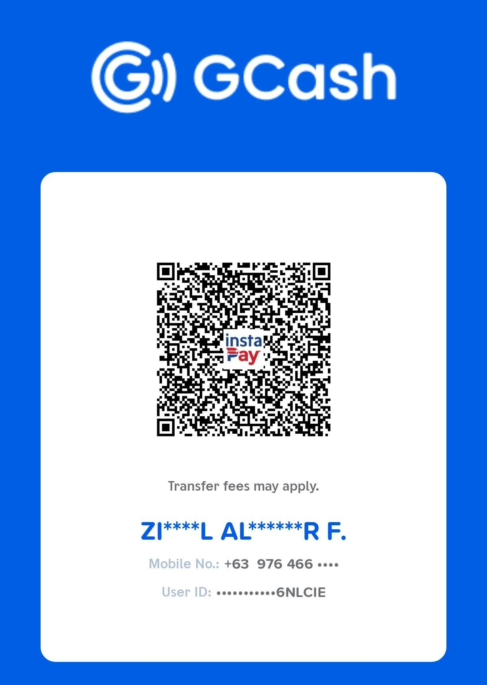
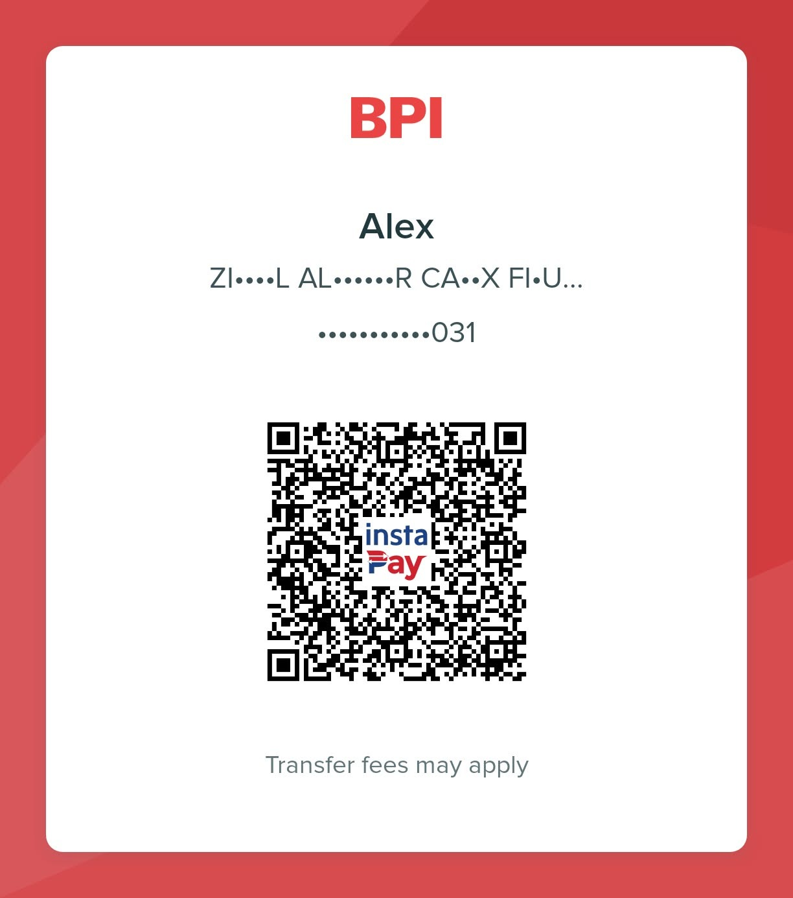

# Support Seiza

Seiza is free and open source, and it stays that way whether or not you
donate. If it's useful to you or your school, a contribution helps keep it
maintained.

## International

- **Ko-fi:** [ko-fi.com/seizadeveloper](https://ko-fi.com/seizadeveloper),
  by card or PayPal, no account needed.
- **GitHub Sponsors:** the **Sponsor** button at the top of the repository,
  once it is enabled, for one-off or monthly support.

## In the Philippines

Scan with any banking or e-wallet app that supports InstaPay QR, or send to
the details below.

<table>
  <tr>
    <td align="center" width="50%"></td>
    <td align="center" width="50%"></td>
  </tr>
  <tr>
    <td align="center"><b>GCash</b> 0976 466 8113 Ziedell Figueroa</td>
    <td align="center"><b>BPI</b> Account 1319 2580 31 Ziedell Figueroa</td>
  </tr>
</table>

Transfer fees may apply, depending on your bank or wallet.

## Setup and customization

If your school or organization would like Seiza set up, customized, or
maintained for you, see [Support and services](README.md#-support-and-services)
in the README, or email **seizadeveloper@gmail.com**.
