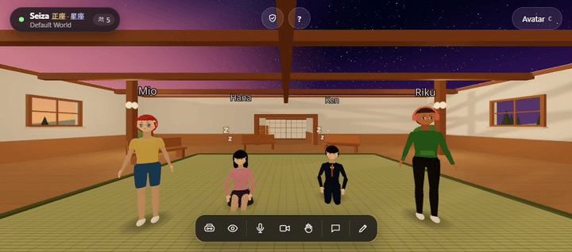
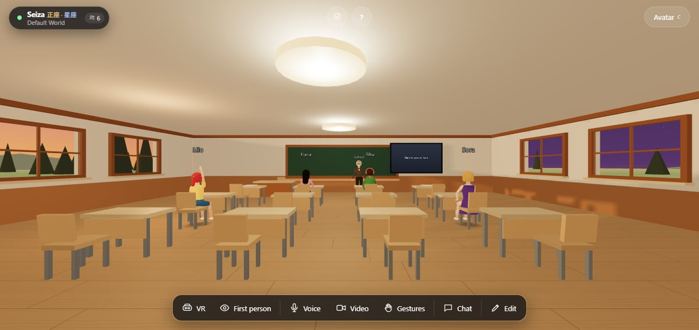
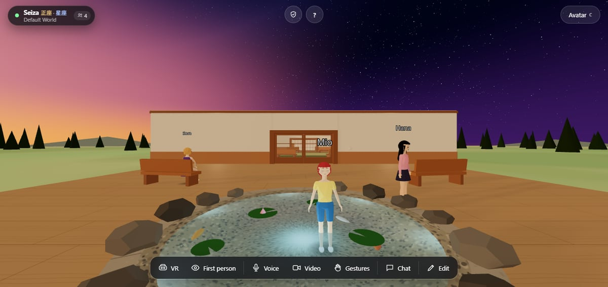
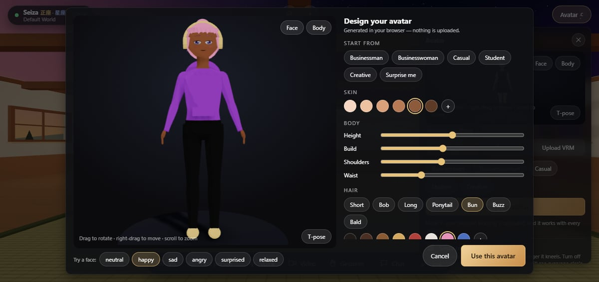
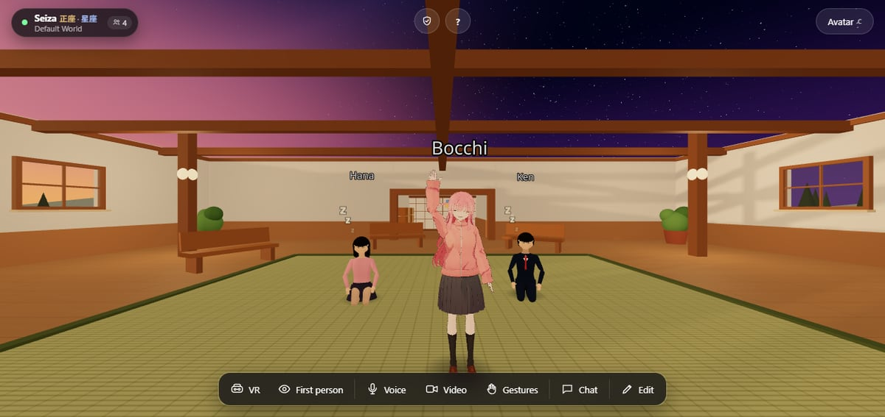

# 🌸 Seiza

Seiza is a small 3D world that people can walk around in together from a web
browser. It runs entirely on your own Cloudflare account, not on a server
that someone else operates.

<p align="center">
  
</p>

Pick a name and an avatar, open the link, and you are in a room with everyone
else who opened it. Nothing to install, and no headset needed (though it
works with one).

Seiza is a self-hosted complement to hosted spaces such as FrameVR, not a
replacement. It is smaller and plainer. In return, you get a room that nobody
else can shut down, re-price, or take your data out of.

[](https://deploy.workers.cloudflare.com/?url=https://github.com/yesiamalex/Seiza)
[](LICENSE)

For the full guide, see [DOCS.md](DOCS.md).

## 🏯 What you can do in a room

- **Walk around** a hall, a classroom, and a garden, and sit on the chairs and
  benches.
- **Talk.** Voices get quieter with distance, so two small conversations can
  happen in one room.
- **Use your camera or share your screen** onto one of the wall screens, for
  example to show slides.
- **Write on the notice boards**, hang pictures, and put up signs. Anyone in
  the room can do this.
- **Wave, bow, clap, raise your hand, kneel, or crouch.** Your avatar's face
  changes to match. If you kneel in seiza for a minute, your avatar nods off,
  and then its legs fall asleep. You can turn this off in the Avatar menu for
  meetings.
- **Chat by text** if you prefer not to talk.
- **Rearrange the room** in Edit Mode, including replacing the whole
  environment with your own 3D model. Your changes stay for the next person
  who joins.
- **Choose your look.** Build an avatar in the designer, pick a preset, or
  upload your own VRM file.

<table>
  <tr>
    <td width="50%"></td>
    <td width="50%"></td>
  </tr>
  <tr>
    <td align="center"><sub>A class in the classroom</sub></td>
    <td align="center"><sub>Wading in the garden pond</sub></td>
  </tr>
  <tr>
    <td width="50%"></td>
    <td width="50%"></td>
  </tr>
  <tr>
    <td align="center"><sub>Design your own avatar in the browser</sub></td>
    <td align="center"><sub>Or bring a full VRM, like this fan-made model<sup>*</sup></sub></td>
  </tr>
</table>

The same link works on a phone, a laptop, or a VR headset. In a headset, your
avatar follows your head and hands, and turning your left palm toward you
opens a menu for voice and gestures.

## 🔒 Why run it yourself

Hosted worlds keep closing. Mozilla Hubs shut down in 2024, Ready Player Me
in January 2026, and Spatial.io retired its free 3D worlds in July 2026. None
of those closures had to do with whether people still used them.

You, your school, or your club set up Seiza on your own Cloudflare account.
Everything placed in a room, and everyone in it, lives on that account. The
Seiza project does not run a server, so there is nothing in the middle.

## 💸 What it costs

For a class-sized room, it is usually free. Seiza fits in Cloudflare's free
tiers, and audio and video travel directly between browsers instead of
through your server.

The one thing that can cost money is a TURN relay. It is only needed when two
people's networks can't connect directly, and it is off until you turn it on.
Cloudflare includes 1,000 GB per month before charging. See
[Voice and video across networks](DOCS.md#voice-and-video-across-networks).

The free plan covers about 7 hours a day of a full 16-person room. If you
outgrow it, Cloudflare's $5-a-month plan covers about 1,100 person-hours a
month, and every extra dollar about 7,400 more. See [Cost](DOCS.md#cost) for
the tables.

## 🚀 Run your own

You don't need to write code, but you do need to run a few commands.

```bash
npm install
npm run worker:deploy   # builds and deploys everything to your account
```

This deploys one Worker that serves the site, the upload API, and the
real-time room server. The **Deploy to Cloudflare** button does the same
thing, after first copying the repository into your GitHub account.

- Full setup, configuration, and world customization: [DOCS.md](DOCS.md)
- Hosting somewhere other than Cloudflare: [SELF-HOSTING.md](SELF-HOSTING.md)

## 🛡️ Who controls a room

Anyone who joins can walk, talk, present, and write on boards. You can put
room editing behind a password. If you set an **admin key**, whoever has it
gets a participant list and can mute, remove, teleport to, or gather
everyone. This is designed for a teacher running a class. See
[ADMIN.md](ADMIN.md).

Two limits apply:

- Voice goes directly between browsers, so "mute" is a request that the other
  browser follows. The server can't force it.
- There are no user accounts, so removing someone ends their session but
  doesn't stop them from rejoining.

## 🚧 Known limitations

Seiza works, but it isn't production-hardened yet.

- Voice is a peer-to-peer mesh, so it suits rooms of about 12 people, not
  large events.
- Nothing has been load-tested with a full room.
- "Admin" and "editor" are shared passwords, not individual logins.
- There is no drawing whiteboard, no chat history, and no physics for placed
  objects.
- VR support is new and hasn't been tested on a real headset yet.

For the complete list, including what each limit means for safety and
moderation, see [Known limitations](DOCS.md#known-limitations) in DOCS.md.

## 📚 Documentation

| Document | Contents |
|---|---|
| [DOCS.md](DOCS.md) | Deployment, configuration, world customization, how it works, and known limitations |
| [ADMIN.md](ADMIN.md) | Moderation: admin keys, room passwords, and what a host can and can't do |
| [SELF-HOSTING.md](SELF-HOSTING.md) | Running Seiza somewhere other than Cloudflare |
| [CONTRIBUTING.md](CONTRIBUTING.md) | How to contribute, the CLA, and the documentation style guide |
| [THIRD_PARTY_ASSETS.md](THIRD_PARTY_ASSETS.md) | Asset licenses, including uploaded avatars |

## 🤝 Support and services

Seiza is free and open source. If it's useful to you, you can support its
development through [Ko-fi](https://ko-fi.com/seizadeveloper), GitHub
Sponsors, or, in the Philippines, GCash or BPI. See [DONATE.md](DONATE.md).

If your school or organization would like its own deployment set up,
customized (a different world, branding, or features), or maintained, without
working with the code yourselves, this is available as a paid service. Email
**seizadeveloper@gmail.com** to discuss what you need.

This is separate from licensing. Running Seiza under the AGPL is free and
needs no permission; [COMMERCIAL-LICENSE.md](COMMERCIAL-LICENSE.md) only
matters if you want to use it in a closed-source product.

## ⚖️ License

Seiza is dual-licensed:

- **AGPL-3.0-or-later** ([LICENSE](LICENSE)) for open and self-hosted use.
- A **commercial license** ([COMMERCIAL-LICENSE.md](COMMERCIAL-LICENSE.md))
  for proprietary use.

3D assets are licensed separately. See
[THIRD_PARTY_ASSETS.md](THIRD_PARTY_ASSETS.md).

The avatars in the GIF and screenshots were made with Seiza's built-in designer,
plus the CC0 VRoid Studio sample "Sendagaya Shino" (pixiv Inc.) and the
fan-made model credited below.

<sup>*</sup> The pink-haired avatar is "Hitori 'Bocchi' Gotoh", a fan-made VRM by
[@wawari_w](https://hub.vroid.com/en/users/42324143), of the character from *Bocchi the
Rock!* (© Aki Hamaji / Houbunsha / Aniplex). It appears only in the GIF at
the top and in this screenshot, from the maintainer's own copy, to show how an uploaded,
artist-made VRM looks in Seiza. The model is **not** included in this
repository or in any deployment, and its license doesn't allow
redistribution or corporate commercial use. Seiza isn't affiliated with or
endorsed by the model's author or the rights holders.
