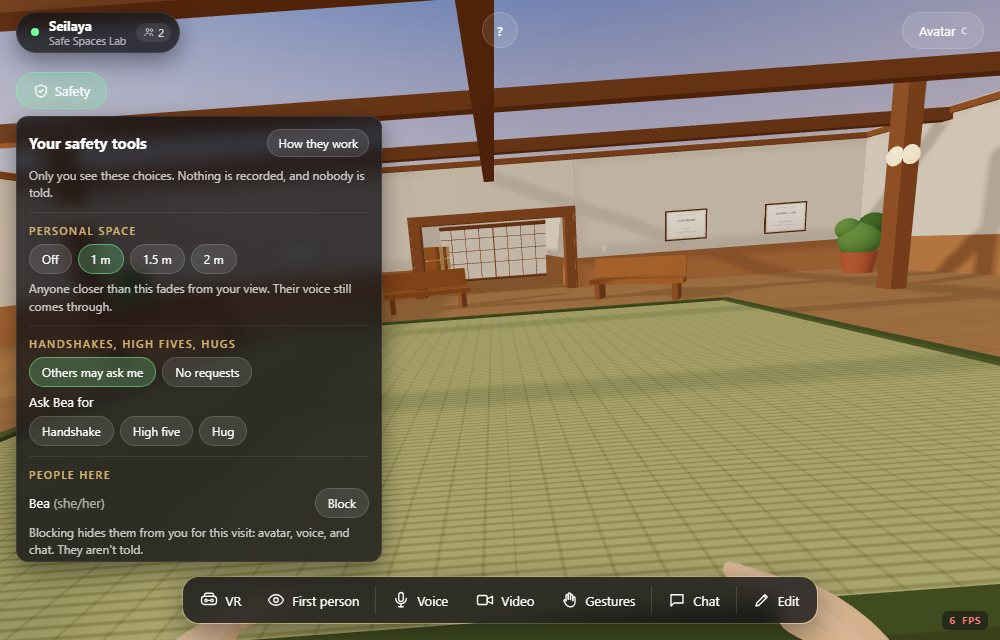
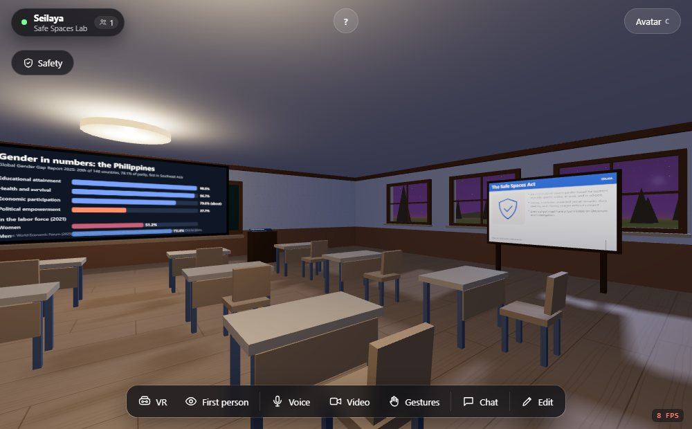
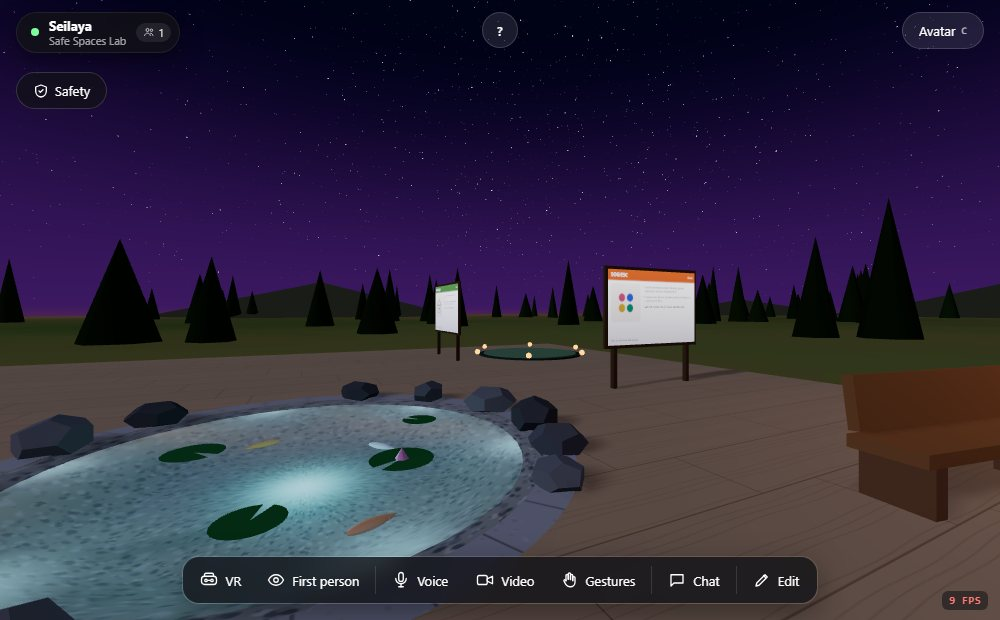

# Seilaya

**Seilaya: Safe Spaces Lab** is a world built on Seiza for learning about
gender, safety, and respect, and designed so that it feels safe to everyone
in it. The name joins Seiza's *sei* with the Filipino *laya*, as in
*kalayaan*: freedom, here the freedom to show up as yourself, safely.

It is the third Seiza world, after Seiza's own default world and Seizora
(solar, wind, and storage). Like Seizora, it lives entirely in this folder
and uses Seiza's world extension hook; Seiza's default world is unaffected.

It is also the setting for the gender-focused study *Safe for All?* (UPOU
Research Grant, KASARIAN agenda): its safety features are the ones that
study asks learners about.

<table>
  <tr>
    <td width="50%"></td>
    <td width="50%"></td>
  </tr>
  <tr>
    <td align="center"><sub>Your safety tools</sub></td>
    <td align="center"><sub>Learning stations in the classroom</sub></td>
  </tr>
  <tr>
    <td colspan="2"></td>
  </tr>
  <tr>
    <td colspan="2" align="center"><sub>The garden at night: the SOGIESC board and Kanlungan, the refuge</sub></td>
  </tr>
</table>

## What's in it

### Safety tools, for every visitor

Under the **Safety** button at the top left:

- **Personal space.** Off, 1, 1.5, or 2 m (1 m by default). Anyone who comes
  closer fades from your view, and a soft ring shows your boundary while
  they're inside it. Their voice still comes through.
- **Together gestures that need a yes.** Stand within 2.5 m of someone to
  ask them for a handshake, a high five, or a hug. They get a prompt; the
  gesture plays on both avatars only if they accept. No answer within 20
  seconds means no, and after a "no" you can't ask the same person again
  for 30 seconds. You can turn off requests entirely. These are Seiza's own
  together gestures, in every world, with consent enforced by the room
  server (see DOCS.md, "Together gestures"). Seilaya adds its own rules on
  top: requests are turned away without a prompt from someone you blocked,
  while you're in Kanlungan, or while a facilitator has paused them, and
  your partner stays visible through your personal space while it plays.
- **Block.** Hides someone from you for this visit: their avatar, name,
  voice, chat messages, and chat bubbles. They aren't told, and their
  requests are turned away without a prompt.
- **Pronouns.** Optional: she/her, he/him, or they/them, shown under your
  name to the people in the room. A fixed list rather than free text, so a
  tag can never carry anyone's own words.
- **Step out to Kanlungan** (refuge). Takes you to a mat in the garden's
  back corner, where you don't see or hear anyone and nobody can ask you
  for anything, until you return to where you were or rejoin from there.
- **If something happened.** Steps to take, and who to contact.

On a first visit, everyone reads and agrees to a short **code of conduct**
before entering.

### Facilitators

A facilitator is simply one of the room's editors (or, where the
deployment has an admin key, a signed-in admin): Seiza's usual permission,
nothing new to set up. **Set an editor password or an admin key on the
Seilaya Worker**, or every visitor counts as an editor. Facilitators get a
Facilitator section in the Safety panel:

- pause handshake, high five, and hug requests for everyone;
- set a minimum personal space for everyone;
- post a short notice (64 characters) that everyone sees;
- "Show this to everyone" on any card, which opens it for the whole room.

These go through Seiza's shared world state, which the room server lets
only editors change. Admins also keep Seiza's own Admin menu: mute, remove,
gather.

### In a headset

Seiza's flat-screen HUD isn't visible in VR, so Seilaya draws its own
panels in the world (`client/Xr.tsx`): a small Safety chip low on the left
of your view opens the safety panel; requests appear in front of you with
Yes and No thanks; and station cards, the quiz, and the bystander scenario
open in front of you. Point with a controller (or hand) and press the
trigger (or pinch). Panels stay put until you turn well away, then drift
back. To check them without a headset, add `?seilayaXrPreview` to the URL.

When a together gesture starts, both people turn to face each other on a
flat screen. In a headset nobody's view is turned for them (that makes
people sick), so they turn themselves.

### On a phone

The Safety panel takes the width of the screen and stops above the touch
controls; requests and notices appear at the top, clear of the joystick
and buttons; and every button is finger-sized.

None of this is recorded. Settings are kept on the visitor's own device;
blocks last for the visit. Requests and pronouns go only to the person
concerned, as private messages the room server relays without reading.

These are not direct messages: nobody can type anything to one person.
Requests go through Seiza's room server, which only accepts one of three
gestures, checks distance, and limits how often anyone can ask (four times
per person per two minutes, nothing for 30 seconds after a no or no answer).
The only private message Seilaya sends itself is a pronoun from the fixed
list, checked on arrival and accepted at most every two seconds per sender;
the room server caps every world message at 1 KB, a burst of 20, and 4 a
second.

### Learning stations

Each opens a card with its sources when clicked.

| Where | Station |
| --- | --- |
| Hall, by the entrance | Welcome board |
| Hall, back wall | Women in Philippine science: four plaques |
| Classroom, front wall | Gender in numbers: the Global Gender Gap Report 2025 and labor force participation |
| Classroom, front right | *Is this harassment?* Six situations, each answered from the Safe Spaces Act |
| Classroom, left side | *What would you do?* A bystander scenario and the 5Ds |
| Classroom, right wall | The Safe Spaces Act (RA 11313) |
| Classroom, left wall | Gender and development: the Magna Carta of Women and the 5% GAD budget |
| Garden | SOGIESC, Safe by design (CPTED), and Kanlungan |

The garden's lampposts and the stations' night lighting come from Seiza
itself; the *Safe by design* station explains why lighting and sightlines
are part of feeling safe.

## How it's built

```
worlds/seilaya/
  world/world.json          The world: sky, spawn, and avatars
  client/                   The world's own code, loaded by Seiza only for this world:
    index.tsx               The Scene: wires everything up
    safety.ts               Settings, blocks, refuge, pronouns, and Seilaya's rules for together gestures
    Social.tsx              Personal space checks, the boundary ring, pronoun tags
    Hud.tsx                 The Safety panel, prompts, banners, and cards (flat screen and phone)
    Xr.tsx                  The same, as panels in the world, for headsets
    Exhibits.tsx            Boards, plaques, the data screen, podiums, the refuge mat
    info.ts                 Every card's text, the quiz, and the bystander scenario
    references.ts           The sources
    kit.tsx                 Canvas boards and clickable parts (forked from Seizora's)
    safety.test.ts          Tests for Seilaya's request rules, the refuge, and pronouns
  favicon.svg               Seilaya's tab icon
  build.mjs                 Builds the deployment into dist/
  wrangler.jsonc            Seilaya's own Worker
```

Seilaya needs a few things from Seiza that a world couldn't do before. They
were added to Seiza as generic, opt-in hooks (see DOCS.md, "World code"),
and all of Seilaya's own logic stays here:

- the players, this visitor's position, a way to play a gesture, to move
  this visitor, and to turn them to face someone;
- private messages between two visitors, carried on the room's existing
  relay, with tight size and rate limits;
- a per-viewer filter for who this visitor sees and hears
  (`src/multiplayer/playerFilter.ts`), which Seiza applies to avatars, name
  tags, voice, chat, and bubbles;
- `hidden` on a world's custom gestures, so they stay out of the menu.

The handshake, high five, and hug began here and moved into Seiza itself,
so every world has them; their clips are generated with Seiza's other
gestures (`scripts/generate-motions.mjs`).

### For a school's own deployment

Edit `HELP_CONTACTS` in `client/info.ts` with your school's Committee on
Decorum and Investigation and gender and development office. The Safe
Spaces Act requires every school to name who receives complaints.

## Build and run locally

```bash
npm install                                   # once, at the repository root
node worlds/seilaya/build.mjs                 # builds into dist/
npx wrangler dev --config worlds/seilaya/wrangler.jsonc
```

Then open http://localhost:8787. Building Seiza's default world afterwards
(`npm run build`) puts dist/ back to the default.

## Deploy from the Cloudflare dashboard

The same steps as Seizora (see `worlds/seizora/README.md`), with:

- **Project name:** `seilaya` (matches `"name"` in `worlds/seilaya/wrangler.jsonc`)
- **Build command:** `node worlds/seilaya/build.mjs`
- **Deploy command:** `npx wrangler deploy --config worlds/seilaya/wrangler.jsonc`

Secrets belong to one Worker, so add Seilaya's own under **Settings >
Variables and Secrets**: the TURN key and token for voice across networks,
and `SEIZA_ADMIN_KEY` so a facilitator can sign in as admin to mute, remove,
or gather people.

## What it isn't

Seilaya's safety tools reduce harm; they don't replace a facilitator, a
school's grievance process, or the law. The law summaries on the cards
aren't legal advice. The statistics are the latest published figures as of
2026, from the agencies named on each card.

## References

- Republic of the Philippines. (2019, April 17). *Republic Act No. 11313: Safe Spaces Act*. https://www.officialgazette.gov.ph/downloads/2019/04apr/20190417-RA-11313-RRD.pdf
- Republic of the Philippines. (2009, August 14). *Republic Act No. 9710: The Magna Carta of Women*. https://issuances-library.senate.gov.ph/sites/default/files/2023-02/ra%25209710.pdf
- Philippine Commission on Women. (2025). *Memorandum Circular No. 2025-06* (FY 2026 GAD plans and budget).
- World Economic Forum. (2025). *Global Gender Gap Report 2025*, Philippine results via the Philippine Commission on Women.
- Philippine Statistics Authority. (2024). *Work and economic participation: 2024 fact sheet on women and men*.
- United Nations OHCHR. (2019). *Born free and equal* (2nd ed.). https://digitallibrary.un.org/record/3974380
- *The Yogyakarta Principles plus 10*. (2017). https://yogyakartaprinciples.org/principles-en/yp10/
- Cozens, P., & Love, T. (2015). A review and current status of crime prevention through environmental design (CPTED). *Journal of Planning Literature, 30*(4), 393–412. https://doi.org/10.1177/0885412215595440
- Right To Be. *The 5Ds of bystander intervention*. https://righttobe.org/youth/
- Blackwell, L., Ellison, N., Elliott-Deflo, N., & Schwartz, R. (2019). Harassment in social virtual reality: Challenges for platform governance. *Proceedings of the ACM on Human-Computer Interaction, 3*(CSCW), 1–25. https://doi.org/10.1145/3359202
- Freeman, G., Zamanifard, S., Maloney, D., & Acena, D. (2022). Disturbing the peace: Experiencing and mitigating emerging harassment in social virtual reality. *Proceedings of the ACM on Human-Computer Interaction, 6*(CSCW1), 1–30. https://doi.org/10.1145/3512932
- Maloney, D., Freeman, G., & Robb, A. (2021). Social virtual reality: Ethical considerations and future directions for an emerging research space. *2021 IEEE VRW*, 271–277. https://doi.org/10.1109/VRW52623.2021.00056
- Drexel University College of Medicine; UP Diliman OICA; Philippine Star (2008) and FlipScience, for the science plaques.
